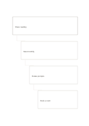

# Stepped hierarchy notes

`stepped-hierarchy` · `hierarchy` · `a5-draft`

[繁體中文](README.zh-TW.md) · [English](README.en.md) · [日本語](README.ja.md) · [Back to catalog](../../docs/en/catalog.md)

Turn an abstract intention into increasingly concrete, actionable levels.

## When to use it

- Translate an event purpose into work items.
- Move from a broad argument to an example and a check.

## How to use it

1. State the overall aim on the first step.
2. Add one level of specificity at each step, preserving the connection above.
3. Make the last step observable and check that it follows from earlier ones.

## What the page helps you see

Levels of a goal or topic, with gaps easier to notice.

## Worked example

A fictional reading circle moves from 'share reading' to 'monthly meeting', 'rotating questions', and 'book a room'.

[SVG](examples/en.svg)

## When not to use it

Steps can imply a necessary sequence; use a tree or columns for parallel branches.

## Downloads

- [Wordless SVG](exports/a5-draft/blank.svg)
- [Wordless PDF](exports/a5-draft/blank.pdf)
- [PDF with English name at top left](exports/a5-draft/titled.pdf)
- [Darker-ink wordless PDF](exports/a5-contrast/blank.pdf)
- [Darker-ink SVG](exports/a5-contrast/blank.svg)

The English name appears only on the titled PDF; the wordless version remains available for free writing.

Page size: A5 (148 × 210 mm); profile: `a5-draft`.

## Provenance and status

Original layout · Detailed source record: [manifest.json](manifest.json)  
[MIT license scope](../../LICENSE-SCOPE.md)

[Trilingual glossary](../../docs/en/glossary.md)

## Modify and rebuild

Change `profiles/a5-draft.json` or the corresponding builder in `src/noteformats/layouts/`, then run from the project root:

`python scripts/build.py --ids stepped-hierarchy`
