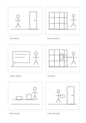

# Six-panel storyboard

`storyboard-6` · `storyboard` · `a5-draft`

[繁體中文](README.zh-TW.md) · [English](README.en.md) · [日本語](README.ja.md) · [Back to catalog](../../docs/en/catalog.md)

Sketch a sequence in six frames and add one short action note beneath each image.

## When to use it

- Check whether shots connect before making a short video.
- Map six moments a person sees while using a service.

## How to use it

1. Decide the start and end of the six-frame sequence in one sentence.
2. Sketch rough compositions in reading order without polishing details.
3. Write a brief action, sound, or transition note under each frame.
4. Read the sequence through and revise any jump that is too large.

## What the page helps you see

A visual sequence showing transitions and missing shots.

## Worked example

A fictional library visit moves from entering, browsing, checking the catalog, finding a book, borrowing it, and leaving; the caption strips name each action.

[SVG](examples/en.svg)

## When not to use it

A long sequence or production that needs exact shot timing requires more frames and a fuller specification.

## Downloads

- [Wordless SVG](exports/a5-draft/blank.svg)
- [Wordless PDF](exports/a5-draft/blank.pdf)
- [PDF with English name at top left](exports/a5-draft/titled.pdf)
- [Darker-ink wordless PDF](exports/a5-contrast/blank.pdf)
- [Darker-ink SVG](exports/a5-contrast/blank.svg)

The English name appears only on the titled PDF; the wordless version remains available for free writing.

Page size: A5 (148 × 210 mm); profile: `a5-draft`.

## Provenance and status

Adaptation of a traditional format · Detailed source record: [manifest.json](manifest.json)  
[MIT license scope](../../LICENSE-SCOPE.md)

[Trilingual glossary](../../docs/en/glossary.md)

## Modify and rebuild

Change `profiles/a5-draft.json` or the corresponding builder in `src/noteformats/layouts/`, then run from the project root:

`python scripts/build.py --ids storyboard-6`
