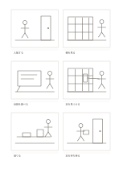

# 6コマの絵コンテ

`storyboard-6` · `storyboard` · `a5-draft`

[繁體中文](README.zh-TW.md) · [English](README.en.md) · [日本語](README.ja.md) · [一覧へ戻る](../../docs/ja/catalog.md)

六つの場面で出来事の順序を下描きし、各コマの下に短い説明を添えます。

## 向いている場面

- 短い動画を作る前に、場面のつながりを確かめるとき。
- サービス利用中に見える六つの重要な場面を考えるとき。

## 使い方

1. 六コマの始まりと終わりを一文で決めます。
2. 読む順番に大まかな構図を描き、細部は後回しにします。
3. 各コマの下に動作、音、切り替えを短く書きます。
4. 通して見て、飛躍が大きい箇所の順序や内容を直します。

## 記入後に見えること

連続した場面から変化や足りないカットが見えます。

## 記入例

架空の図書館で本を借りる流れを例に、入館、棚を見る、目録を調べる、本を見つける、貸出、退館を並べています。

[SVG](examples/ja.svg)

## 向いていない場面

長い物語や正確な秒数が必要な制作には、六コマと短い説明欄だけでは足りません。

## ダウンロード

- [文字なしSVG](exports/a5-draft/blank.svg)
- [文字なしPDF](exports/a5-draft/blank.pdf)
- [左上に英語名があるPDF](exports/a5-draft/titled.pdf)
- [濃い線の文字なしPDF](exports/a5-contrast/blank.pdf)
- [濃い線のSVG](exports/a5-contrast/blank.svg)

英語名は表題付きPDFだけに印刷され、文字なし版は自由な記入に使えます。

用紙サイズ：A5（148 × 210 mm）。設定ファイル：`a5-draft`。

## 由来と状態

伝統的な形式の応用 · 詳しい由来の記録： [manifest.json](manifest.json)  
[MITライセンスの範囲](../../LICENSE-SCOPE.md)

[三言語の用語集](../../docs/ja/glossary.md)

## 変更と再生成

`profiles/a5-draft.json` または `src/noteformats/layouts/` の描画関数を変更し、プロジェクトのルートで実行します：

`python scripts/build.py --ids storyboard-6`
