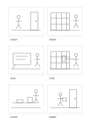

# 六格故事板

`storyboard-6` · `storyboard` · `a5-draft`

[繁體中文](README.zh-TW.md) · [English](README.en.md) · [日本語](README.ja.md) · [返回目錄](../../docs/zh-TW/catalog.md)

用六個連續畫面草擬事件順序，並在每格下方補一句描述。

## 適合情境

- 設計短影片前，先看鏡頭之間是否能連起來。
- 規劃服務使用流程時，描繪使用者看到的六個關鍵時刻。

## 使用步驟

1. 先用一行文字決定這六格要呈現的起點與終點。
2. 按閱讀順序在畫面框中畫粗略構圖，不追求細節。
3. 在各框下方寫動作、聲音或轉場的短註。
4. 通讀六格，找出跳躍太大的位置，再修改畫面順序。

## 整理後可得到

從連續畫面看出事件轉折與仍缺的鏡頭。

## 實際填寫示例

以虛構的借書流程為例：走進圖書館、找書、查看目錄、取書、借閱、離開，註解帶寫每一步的動作。

[SVG](examples/zh-TW.svg)

## 不適合情境

長篇分鏡或需要精確鏡頭時長的製作，六格和簡短註解帶不足以承載全部規格。

## 下載

- [無字 SVG](exports/a5-draft/blank.svg)
- [無字 PDF](exports/a5-draft/blank.pdf)
- [左上角英文名稱 PDF](exports/a5-draft/titled.pdf)
- [深色墨線無字 PDF](exports/a5-contrast/blank.pdf)
- [深色墨線 SVG](exports/a5-contrast/blank.svg)

英文名稱只印在標題版 PDF；無字版仍適合自由列印與改作。

頁面尺寸：A5（148 × 210 mm）；設定檔：`a5-draft`。

## 來源與狀態

傳統格式改編 · 詳細來源紀錄見 [manifest.json](manifest.json)  
[MIT 授權範圍](../../LICENSE-SCOPE.md)

[三語術語表](../../docs/zh-TW/glossary.md)

## 修改與重新生成

修改 `profiles/a5-draft.json` 或 `src/noteformats/layouts/` 內對應的繪圖函式，再於專案根目錄執行：

`python scripts/build.py --ids storyboard-6`
