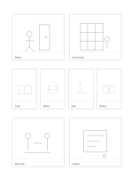

# Mixed-scale eight-panel storyboard

`storyboard-eight-mixed` · `storyboard` · `a5-draft`

[繁體中文](README.zh-TW.md) · [English](README.en.md) · [日本語](README.ja.md) · [Back to catalog](../../docs/en/catalog.md)

Use broad frames for scenes, four small beats for action, and broad frames for the close.

## When to use it

- Plan the opening, movement, and ending of a short video.
- Describe eight moments of a workshop visit.

## How to use it

1. Read left to right and top to bottom, establishing scenes in the large frames.
2. Give each small frame one change of action rather than a long dialogue.
3. Use the final broad frames for outcome and reaction, with one short caption below each.

## What the page helps you see

A visual sequence showing transitions and missing shots.

## Worked example

A fictional film enters a library and finds a book, then turns pages, writes, asks, exchanges, discusses, and leaves.

[SVG](examples/en.svg)

## When not to use it

Small panels cannot carry detail or long prose; production still needs timing, sound, and camera planning.

## Downloads

- [Wordless SVG](exports/a5-draft/blank.svg)
- [Wordless PDF](exports/a5-draft/blank.pdf)
- [PDF with English name at top left](exports/a5-draft/titled.pdf)
- [Darker-ink wordless PDF](exports/a5-contrast/blank.pdf)
- [Darker-ink SVG](exports/a5-contrast/blank.svg)

The English name appears only on the titled PDF; the wordless version remains available for free writing.

Page size: A5 (148 × 210 mm); profile: `a5-draft`.

## Provenance and status

Original layout · Detailed source record: [manifest.json](manifest.json)  
[MIT license scope](../../LICENSE-SCOPE.md)

[Trilingual glossary](../../docs/en/glossary.md)

## Modify and rebuild

Change `profiles/a5-draft.json` or the corresponding builder in `src/noteformats/layouts/`, then run from the project root:

`python scripts/build.py --ids storyboard-eight-mixed`
