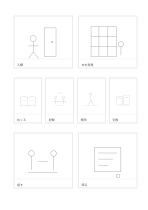

# 大小混合の八コマ絵コンテ

`storyboard-eight-mixed` · `storyboard` · `a5-draft`

[繁體中文](README.zh-TW.md) · [English](README.en.md) · [日本語](README.ja.md) · [一覧へ戻る](../../docs/ja/catalog.md)

大きなコマで場面を示し、中央の四小コマで動きを進め、最後を大きく締めます。

## 向いている場面

- 短い映像の始まり、動き、終わりを考えるとき。
- 講座への入場から終了までを八場面で示すとき。

## 使い方

1. 左から右、上から下に読み、大コマで場面を決めます。
2. 小コマには一つの動作変化だけを描きます。
3. 最後の大コマで結果と反応を示し、各コマ下に短い説明を書きます。

## 記入後に見えること

連続した場面から変化や足りないカットが見えます。

## 記入例

架空の短編で図書館に入り、本を見つけ、ページをめくり、記録し、問い、交換し、話し、帰ります。

[SVG](examples/ja.svg)

## 向いていない場面

小コマに細部や長文は入りません。撮影には時間、音、カメラの計画も必要です。

## ダウンロード

- [文字なしSVG](exports/a5-draft/blank.svg)
- [文字なしPDF](exports/a5-draft/blank.pdf)
- [左上に英語名があるPDF](exports/a5-draft/titled.pdf)
- [濃い線の文字なしPDF](exports/a5-contrast/blank.pdf)
- [濃い線のSVG](exports/a5-contrast/blank.svg)

英語名は表題付きPDFだけに印刷され、文字なし版は自由な記入に使えます。

用紙サイズ：A5（148 × 210 mm）。設定ファイル：`a5-draft`。

## 由来と状態

本プロジェクトの独自レイアウト · 詳しい由来の記録： [manifest.json](manifest.json)  
[MITライセンスの範囲](../../LICENSE-SCOPE.md)

[三言語の用語集](../../docs/ja/glossary.md)

## 変更と再生成

`profiles/a5-draft.json` または `src/noteformats/layouts/` の描画関数を変更し、プロジェクトのルートで実行します：

`python scripts/build.py --ids storyboard-eight-mixed`
