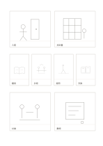

# 大小交錯八格故事板

`storyboard-eight-mixed` · `storyboard` · `a5-draft`

[繁體中文](README.zh-TW.md) · [English](README.en.md) · [日本語](README.ja.md) · [返回目錄](../../docs/zh-TW/catalog.md)

用大畫面交代場景，中間四小格快速推進動作，再用大畫面收束。

## 適合情境

- 構思一段短影片的開場、連續動作與結尾。
- 說明工作坊從入場到完成的八個畫面。

## 使用步驟

1. 依左到右、上到下順序畫八格，先用大格定場景。
2. 四個小格只畫一個動作變化，避免塞進對白。
3. 最後兩大格補結果與反應，格底寫一行必要描述。

## 整理後可得到

從連續畫面看出事件轉折與仍缺的鏡頭。

## 實際填寫示例

虛構短片先畫走進圖書館與找到書，中間四格畫翻頁、抄寫、提問、交換，最後畫討論與離場。

[SVG](examples/zh-TW.svg)

## 不適合情境

小格不適合細節或長句；正式拍攝還需鏡頭、時間與聲音規劃。

## 下載

- [無字 SVG](exports/a5-draft/blank.svg)
- [無字 PDF](exports/a5-draft/blank.pdf)
- [左上角英文名稱 PDF](exports/a5-draft/titled.pdf)
- [深色墨線無字 PDF](exports/a5-contrast/blank.pdf)
- [深色墨線 SVG](exports/a5-contrast/blank.svg)

英文名稱只印在標題版 PDF；無字版仍適合自由列印與改作。

頁面尺寸：A5（148 × 210 mm）；設定檔：`a5-draft`。

## 來源與狀態

本專案原創版面 · 詳細來源紀錄見 [manifest.json](manifest.json)  
[MIT 授權範圍](../../LICENSE-SCOPE.md)

[三語術語表](../../docs/zh-TW/glossary.md)

## 修改與重新生成

修改 `profiles/a5-draft.json` 或 `src/noteformats/layouts/` 內對應的繪圖函式，再於專案根目錄執行：

`python scripts/build.py --ids storyboard-eight-mixed`
