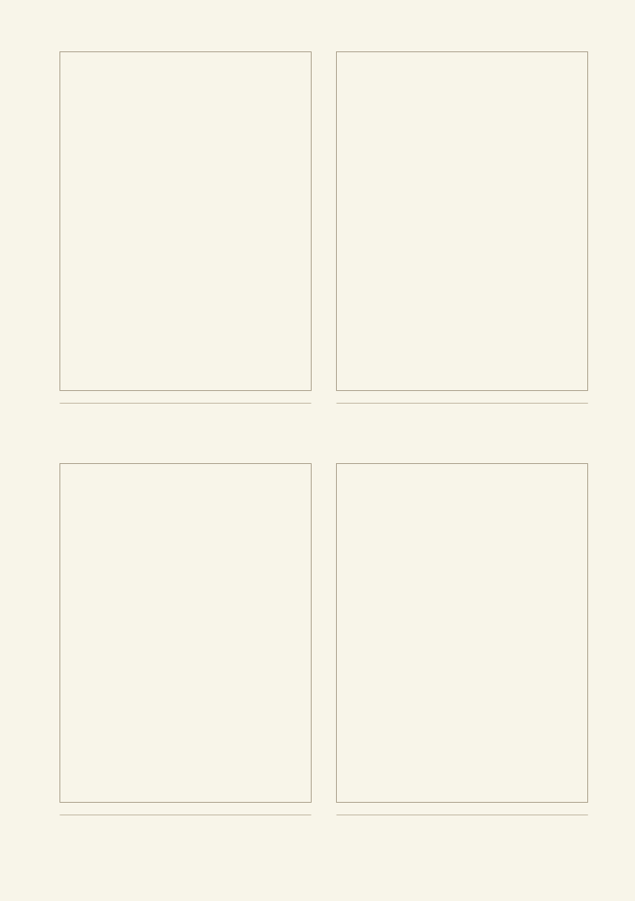
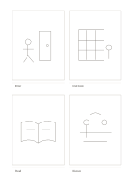

# Four-panel storyboard

`storyboard-four` · `storyboard` · `a5-draft`

[繁體中文](README.zh-TW.md) · [English](README.en.md) · [日本語](README.ja.md) · [Back to catalog](../../docs/en/catalog.md)

Show successive changes in one event, with a short action cue for every frame. Geometry change: storyboard frames: 4.

## When to use it

**Geometry relationship:** `parameter` · [storyboard-6](../storyboard-6/README.en.md)

- Show a character's problem, attempt, feedback and adjustment in four frames.
- Break a brief how-to sequence into four pictures with a visible change in each.

## How to use it

1. Divide the event into the number of frames on this page and draw a visible change in each.
2. Use the worked example to place entries in region order: 1: "Enter"; 2: "Find book"; 3: "Read"; 4: "Discuss"
3. Review the regions, mark open questions and choose a next step.

## What the page helps you see

A visual sequence showing transitions and missing shots.

## Worked example

Entries in example-position order; each number identifies one entry:

1. Enter
2. Find book
3. Read
4. Discuss

[SVG](examples/en.svg)

## When not to use it

Four frames help structure a short event but cannot fully capture several subplots; the number of shots or duration represented by a frame must be noted separately.

## Downloads

- [Wordless SVG](exports/a5-draft/blank.svg)
- [Wordless PDF](exports/a5-draft/blank.pdf)
- [PDF with English name at top left](exports/a5-draft/titled.pdf)
- [Darker-ink wordless PDF](exports/a5-contrast/blank.pdf)
- [Darker-ink SVG](exports/a5-contrast/blank.svg)

The English name appears only on the titled PDF; the wordless version remains available for free writing.

Page size: A5 (148 × 210 mm); profile: `a5-draft`.

## Provenance and status

Adaptation of a traditional format · Detailed source record: [manifest.json](manifest.json)  
[MIT license scope](../../LICENSE-SCOPE.md)

[Trilingual glossary](../../docs/en/glossary.md)

## Modify and rebuild

Edit geometry in `src/noteformats/variants.py` or text in `src/noteformats/variant_content.py`, then run from the project root:

`python scripts/build.py --ids storyboard-four`
