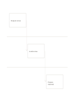

# Three-lane handoff flow

`swimlane-flow` · `flow` · `a5-draft`

[繁體中文](README.zh-TW.md) · [English](README.en.md) · [日本語](README.ja.md) · [Back to catalog](../../docs/en/catalog.md)

Separate three roles into horizontal lanes and follow their handoffs with arrows.

## When to use it

- Sort tasks among event organizers, venue staff, and volunteers.
- Track a document passing through three handlers.

## How to use it

1. Assign one role to each lane.
2. Write the action owned by that role in its lane.
3. Follow each diagonal arrow and check what information the next role needs.

## What the page helps you see

A sequence, branch, or loop that can be traced along its arrows.

## Worked example

A fictional organizer requests a venue, staff confirm a time, and volunteers prepare materials in sequence.

[SVG](examples/en.svg)

## When not to use it

Several parallel branches at once need a more detailed process map.

## Downloads

- [Wordless SVG](exports/a5-draft/blank.svg)
- [Wordless PDF](exports/a5-draft/blank.pdf)
- [PDF with English name at top left](exports/a5-draft/titled.pdf)
- [Darker-ink wordless PDF](exports/a5-contrast/blank.pdf)
- [Darker-ink SVG](exports/a5-contrast/blank.svg)

The English name appears only on the titled PDF; the wordless version remains available for free writing.

Page size: A5 (148 × 210 mm); profile: `a5-draft`.

## Provenance and status

Adaptation of a traditional format · Detailed source record: [manifest.json](manifest.json)  
[MIT license scope](../../LICENSE-SCOPE.md)

[Trilingual glossary](../../docs/en/glossary.md)

## Modify and rebuild

Change `profiles/a5-draft.json` or the corresponding builder in `src/noteformats/layouts/`, then run from the project root:

`python scripts/build.py --ids swimlane-flow`
