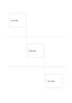

# 三つのレーンの引継ぎ

`swimlane-flow` · `flow` · `a5-draft`

[繁體中文](README.zh-TW.md) · [English](README.en.md) · [日本語](README.ja.md) · [一覧へ戻る](../../docs/ja/catalog.md)

三役の仕事を横の帯で分け、矢印で引継ぎを追います。

## 向いている場面

- 主催者、会場、手伝いの仕事を整理するとき。
- 書類が三人の担当者を通る流れを記録するとき。

## 使い方

1. 各レーンに一人の役割を割り当てます。
2. その役割の動作を対応する帯に書きます。
3. 斜めの矢印をたどり、次の担当者に必要な情報を確かめます。

## 記入後に見えること

矢印に沿って順序、分岐、循環を追えます。

## 記入例

架空の主催者が会場を依頼し、会場側が時間を確認し、手伝いが材料を用意する流れです。

[SVG](examples/ja.svg)

## 向いていない場面

同時に複数の枝が走る複雑な工程には、より詳しい図が必要です。

## ダウンロード

- [文字なしSVG](exports/a5-draft/blank.svg)
- [文字なしPDF](exports/a5-draft/blank.pdf)
- [左上に英語名があるPDF](exports/a5-draft/titled.pdf)
- [濃い線の文字なしPDF](exports/a5-contrast/blank.pdf)
- [濃い線のSVG](exports/a5-contrast/blank.svg)

英語名は表題付きPDFだけに印刷され、文字なし版は自由な記入に使えます。

用紙サイズ：A5（148 × 210 mm）。設定ファイル：`a5-draft`。

## 由来と状態

伝統的な形式の応用 · 詳しい由来の記録： [manifest.json](manifest.json)  
[MITライセンスの範囲](../../LICENSE-SCOPE.md)

[三言語の用語集](../../docs/ja/glossary.md)

## 変更と再生成

`profiles/a5-draft.json` または `src/noteformats/layouts/` の描画関数を変更し、プロジェクトのルートで実行します：

`python scripts/build.py --ids swimlane-flow`
