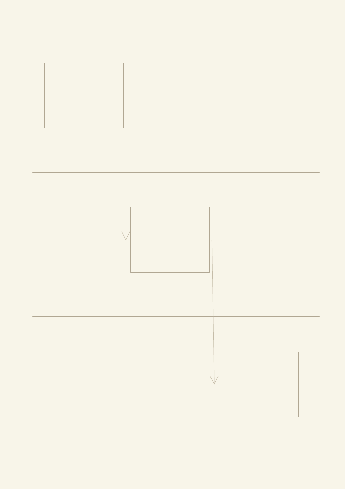
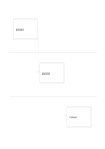

# 三泳道交接流程

`swimlane-flow` · `flow` · `a5-draft`

[繁體中文](README.zh-TW.md) · [English](README.en.md) · [日本語](README.ja.md) · [返回目錄](../../docs/zh-TW/catalog.md)

把三個角色的工作放在不同橫帶，沿箭頭看交接。

## 適合情境

- 整理活動主辦、場地與志工的任務。
- 記錄一份文件在三個處理者間的流轉。

## 使用步驟

1. 先替三條泳道各指定一個角色。
2. 在各帶寫該角色負責的動作。
3. 沿斜箭頭檢查交接資訊與下一步是否清楚。

## 整理後可得到

沿箭頭追查步驟、分岔或循環的先後關係。

## 實際填寫示例

示例由虛構主辦者提出需求、場地確認時段、志工準備材料，依序交接。

[SVG](examples/zh-TW.svg)

## 不適合情境

若同一時間有多條並行支線，這張簡化頁不足以完整表達。

## 下載

- [無字 SVG](exports/a5-draft/blank.svg)
- [無字 PDF](exports/a5-draft/blank.pdf)
- [左上角英文名稱 PDF](exports/a5-draft/titled.pdf)
- [深色墨線無字 PDF](exports/a5-contrast/blank.pdf)
- [深色墨線 SVG](exports/a5-contrast/blank.svg)

英文名稱只印在標題版 PDF；無字版仍適合自由列印與改作。

頁面尺寸：A5（148 × 210 mm）；設定檔：`a5-draft`。

## 來源與狀態

傳統格式改編 · 詳細來源紀錄見 [manifest.json](manifest.json)  
[MIT 授權範圍](../../LICENSE-SCOPE.md)

[三語術語表](../../docs/zh-TW/glossary.md)

## 修改與重新生成

修改 `profiles/a5-draft.json` 或 `src/noteformats/layouts/` 內對應的繪圖函式，再於專案根目錄執行：

`python scripts/build.py --ids swimlane-flow`
