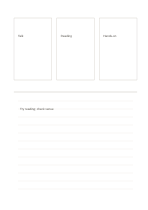

# Three cards with ruled synthesis

`three-cards-and-ruled` · `hybrid` · `a5-draft`

[繁體中文](README.zh-TW.md) · [English](README.en.md) · [日本語](README.ja.md) · [Back to catalog](../../docs/en/catalog.md)

Compare three short ideas above and write the reasoning or choice below.

## When to use it

- Select a workshop topic from three options.
- Find a shared theme across three short readings.

## How to use it

1. Put one independent idea in each upper card.
2. Compare common ground and differences below instead of copying the cards.
3. State a checkable reason for a choice or an open question.

## What the page helps you see

A drawing, short notes, and a conclusion kept separate but connected.

## Worked example

A fictional event compares a talk, reading, and hands-on session; the notes propose a reading trial but flag venue uncertainty.

[SVG](examples/en.svg)

## When not to use it

Three cards do not imply equal weight; quantitative decisions need a data table.

## Downloads

- [Wordless SVG](exports/a5-draft/blank.svg)
- [Wordless PDF](exports/a5-draft/blank.pdf)
- [PDF with English name at top left](exports/a5-draft/titled.pdf)
- [Darker-ink wordless PDF](exports/a5-contrast/blank.pdf)
- [Darker-ink SVG](exports/a5-contrast/blank.svg)

The English name appears only on the titled PDF; the wordless version remains available for free writing.

Page size: A5 (148 × 210 mm); profile: `a5-draft`.

## Provenance and status

Original layout · Detailed source record: [manifest.json](manifest.json)  
[MIT license scope](../../LICENSE-SCOPE.md)

[Trilingual glossary](../../docs/en/glossary.md)

## Modify and rebuild

Change `profiles/a5-draft.json` or the corresponding builder in `src/noteformats/layouts/`, then run from the project root:

`python scripts/build.py --ids three-cards-and-ruled`
