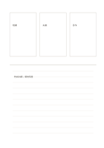

# 三卡片加橫線總結

`three-cards-and-ruled` · `hybrid` · `a5-draft`

[繁體中文](README.zh-TW.md) · [English](README.en.md) · [日本語](README.ja.md) · [返回目錄](../../docs/zh-TW/catalog.md)

先並列三個短想法，再用下方文字寫出比較與選擇。

## 適合情境

- 比較三個工作坊題目後寫出試辦理由。
- 閱讀三段資料後寫一段共同主題。

## 使用步驟

1. 上方三卡各寫一個獨立想法。
2. 在下方比較相同點與差異，避免只是重抄卡片。
3. 寫下一個可查證的選擇理由或待查問題。

## 整理後可得到

把圖、短記與結論放在各自區域，再檢查關係。

## 實際填寫示例

虛構活動的三卡是短講、共讀、手作；下方寫先試共讀，理由是材料較容易準備，但需確認場地。

[SVG](examples/zh-TW.svg)

## 不適合情境

三卡不表示三案應同權重；需要量化決策時另用資料表。

## 下載

- [無字 SVG](exports/a5-draft/blank.svg)
- [無字 PDF](exports/a5-draft/blank.pdf)
- [左上角英文名稱 PDF](exports/a5-draft/titled.pdf)
- [深色墨線無字 PDF](exports/a5-contrast/blank.pdf)
- [深色墨線 SVG](exports/a5-contrast/blank.svg)

英文名稱只印在標題版 PDF；無字版仍適合自由列印與改作。

頁面尺寸：A5（148 × 210 mm）；設定檔：`a5-draft`。

## 來源與狀態

本專案原創版面 · 詳細來源紀錄見 [manifest.json](manifest.json)  
[MIT 授權範圍](../../LICENSE-SCOPE.md)

[三語術語表](../../docs/zh-TW/glossary.md)

## 修改與重新生成

修改 `profiles/a5-draft.json` 或 `src/noteformats/layouts/` 內對應的繪圖函式，再於專案根目錄執行：

`python scripts/build.py --ids three-cards-and-ruled`
