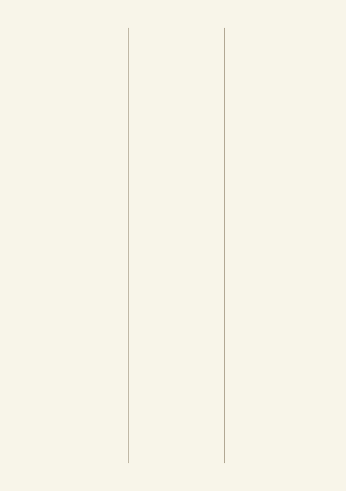
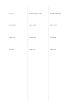

# Three equal columns

`three-columns` · `columns` · `a5-draft`

[繁體中文](README.zh-TW.md) · [English](README.en.md) · [日本語](README.ja.md) · [Back to catalog](../../docs/en/catalog.md)

Compare three parallel streams while preserving each one's vertical context.

## When to use it

- List strengths and questions for three proposals.
- Compare how three sources address the same subject.

## How to use it

1. Assign one source or option to each column.
2. Write short entries downward, keeping comparable items near the same height.
3. Scan across for shared points and gaps that need checking.

## What the page helps you see

Parallel notes whose agreements, differences, and unanswered points can be checked.

## Worked example

Three fictional reading-group venues are compared: a library, community center, and outdoor pavilion.

[SVG](examples/en.svg)

## When not to use it

Each column is only a third of the page; long sentences and large drawings are cramped.

## Downloads

- [Wordless SVG](exports/a5-draft/blank.svg)
- [Wordless PDF](exports/a5-draft/blank.pdf)
- [PDF with English name at top left](exports/a5-draft/titled.pdf)
- [Darker-ink wordless PDF](exports/a5-contrast/blank.pdf)
- [Darker-ink SVG](exports/a5-contrast/blank.svg)

The English name appears only on the titled PDF; the wordless version remains available for free writing.

Page size: A5 (148 × 210 mm); profile: `a5-draft`.

## Provenance and status

Generic geometry · Detailed source record: [manifest.json](manifest.json)  
[MIT license scope](../../LICENSE-SCOPE.md)

[Trilingual glossary](../../docs/en/glossary.md)

## Modify and rebuild

Change `profiles/a5-draft.json` or the corresponding builder in `src/noteformats/layouts/`, then run from the project root:

`python scripts/build.py --ids three-columns`
