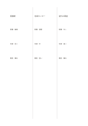

# 等幅の三段組

`three-columns` · `columns` · `a5-draft`

[繁體中文](README.zh-TW.md) · [English](README.en.md) · [日本語](README.ja.md) · [一覧へ戻る](../../docs/ja/catalog.md)

三つの並行する情報を比べ、それぞれの縦の流れも保ちます。

## 向いている場面

- 三案の利点と疑問を比べるとき。
- 三つの資料が同じ話題をどう扱うか整理するとき。

## 使い方

1. 各欄に一つの資料や案を割り当てます。
2. 短い項目を上から書き、比較する項目の高さを近づけます。
3. 横に見て共通点と空欄を探し、確認事項を補います。

## 記入後に見えること

並べた記録から共通点、相違点、未確認事項を確かめられます。

## 記入例

架空の読書会で図書館、地域センター、屋外の東屋という三つの会場を比べています。

[SVG](examples/ja.svg)

## 向いていない場面

各欄はページの三分の一幅なので、長文や大きな図には狭すぎます。

## ダウンロード

- [文字なしSVG](exports/a5-draft/blank.svg)
- [文字なしPDF](exports/a5-draft/blank.pdf)
- [左上に英語名があるPDF](exports/a5-draft/titled.pdf)
- [濃い線の文字なしPDF](exports/a5-contrast/blank.pdf)
- [濃い線のSVG](exports/a5-contrast/blank.svg)

英語名は表題付きPDFだけに印刷され、文字なし版は自由な記入に使えます。

用紙サイズ：A5（148 × 210 mm）。設定ファイル：`a5-draft`。

## 由来と状態

一般的な幾何構造 · 詳しい由来の記録： [manifest.json](manifest.json)  
[MITライセンスの範囲](../../LICENSE-SCOPE.md)

[三言語の用語集](../../docs/ja/glossary.md)

## 変更と再生成

`profiles/a5-draft.json` または `src/noteformats/layouts/` の描画関数を変更し、プロジェクトのルートで実行します：

`python scripts/build.py --ids three-columns`
