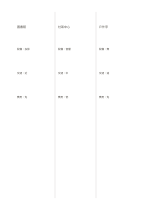

# 等寬三欄

`three-columns` · `columns` · `a5-draft`

[繁體中文](README.zh-TW.md) · [English](README.en.md) · [日本語](README.ja.md) · [返回目錄](../../docs/zh-TW/catalog.md)

讓三組平行資訊同頁對照，保留各自的完整縱向脈絡。

## 適合情境

- 比較三個方案的優點與疑問。
- 整理三份資料對同一主題的觀點。

## 使用步驟

1. 先替三欄各自決定一個來源或方案。
2. 沿欄由上而下寫短項目，對應資訊放在相近高度。
3. 逐列查看共同點與空白，補上仍需查證的資料。

## 整理後可得到

對照分欄內容，找出相同點、差異與待查證資訊。

## 實際填寫示例

示例比較虛構讀書會的三種場地：圖書館、社區中心與戶外亭。

[SVG](examples/zh-TW.svg)

## 不適合情境

每欄寬度只有全頁三分之一，不適合長句或大幅圖。

## 下載

- [無字 SVG](exports/a5-draft/blank.svg)
- [無字 PDF](exports/a5-draft/blank.pdf)
- [左上角英文名稱 PDF](exports/a5-draft/titled.pdf)
- [深色墨線無字 PDF](exports/a5-contrast/blank.pdf)
- [深色墨線 SVG](exports/a5-contrast/blank.svg)

英文名稱只印在標題版 PDF；無字版仍適合自由列印與改作。

頁面尺寸：A5（148 × 210 mm）；設定檔：`a5-draft`。

## 來源與狀態

通用幾何結構 · 詳細來源紀錄見 [manifest.json](manifest.json)  
[MIT 授權範圍](../../LICENSE-SCOPE.md)

[三語術語表](../../docs/zh-TW/glossary.md)

## 修改與重新生成

修改 `profiles/a5-draft.json` 或 `src/noteformats/layouts/` 內對應的繪圖函式，再於專案根目錄執行：

`python scripts/build.py --ids three-columns`
