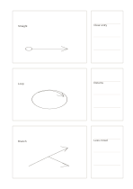

# Three sketch proposals

`three-sketch-proposals` · `ideation` · `a5-draft`

[繁體中文](README.zh-TW.md) · [English](README.en.md) · [日本語](README.ja.md) · [Back to catalog](../../docs/en/catalog.md)

Draw three distinct approaches and keep a short evaluation beside each.

## When to use it

- Compare three poster compositions.
- Sketch three entry routes for a small exhibition.

## How to use it

1. Draw a meaningfully different option in each broad left frame.
2. Use the right strip for one advantage and one question per option.
3. Circle an option to test while retaining the alternatives.

## What the page helps you see

Multiple proposals with a basis for the next selection step.

## Worked example

A fictional exhibition considers straight, loop, and branched visitor paths, noting visibility and congestion beside each.

[SVG](examples/en.svg)

## When not to use it

A sketch is not a measured plan or user test, and the narrow strip cannot hold a full argument.

## Downloads

- [Wordless SVG](exports/a5-draft/blank.svg)
- [Wordless PDF](exports/a5-draft/blank.pdf)
- [PDF with English name at top left](exports/a5-draft/titled.pdf)
- [Darker-ink wordless PDF](exports/a5-contrast/blank.pdf)
- [Darker-ink SVG](exports/a5-contrast/blank.svg)

The English name appears only on the titled PDF; the wordless version remains available for free writing.

Page size: A5 (148 × 210 mm); profile: `a5-draft`.

## Provenance and status

Original layout · Detailed source record: [manifest.json](manifest.json)  
[MIT license scope](../../LICENSE-SCOPE.md)

[Trilingual glossary](../../docs/en/glossary.md)

## Modify and rebuild

Change `profiles/a5-draft.json` or the corresponding builder in `src/noteformats/layouts/`, then run from the project root:

`python scripts/build.py --ids three-sketch-proposals`
