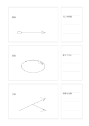

# 三案のスケッチと評価

`three-sketch-proposals` · `ideation` · `a5-draft`

[繁體中文](README.zh-TW.md) · [English](README.en.md) · [日本語](README.ja.md) · [一覧へ戻る](../../docs/ja/catalog.md)

三つの異なる案を描き、各案の横に短い検討メモを書きます。

## 向いている場面

- ポスターの構成を三案比べるとき。
- 小さな展示の入口動線を三通り考えるとき。

## 使い方

1. 左の三枠に色違いだけでない別案を描きます。
2. 右の欄に各案の良い点と確認事項を書きます。
3. 次に試す案を選び、残りの案も消さずに残します。

## 記入後に見えること

複数の案と、次に選ぶための基準が残ります。

## 記入例

架空の展示で直線、回遊、分岐の三動線を描き、入口の見やすさや混雑を横に記します。

[SVG](examples/ja.svg)

## 向いていない場面

草図は寸法図や利用者テストの代わりになりません。狭い欄は長い論証にも向きません。

## ダウンロード

- [文字なしSVG](exports/a5-draft/blank.svg)
- [文字なしPDF](exports/a5-draft/blank.pdf)
- [左上に英語名があるPDF](exports/a5-draft/titled.pdf)
- [濃い線の文字なしPDF](exports/a5-contrast/blank.pdf)
- [濃い線のSVG](exports/a5-contrast/blank.svg)

英語名は表題付きPDFだけに印刷され、文字なし版は自由な記入に使えます。

用紙サイズ：A5（148 × 210 mm）。設定ファイル：`a5-draft`。

## 由来と状態

本プロジェクトの独自レイアウト · 詳しい由来の記録： [manifest.json](manifest.json)  
[MITライセンスの範囲](../../LICENSE-SCOPE.md)

[三言語の用語集](../../docs/ja/glossary.md)

## 変更と再生成

`profiles/a5-draft.json` または `src/noteformats/layouts/` の描画関数を変更し、プロジェクトのルートで実行します：

`python scripts/build.py --ids three-sketch-proposals`
