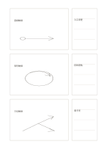

# 三案草圖與評估

`three-sketch-proposals` · `ideation` · `a5-draft`

[繁體中文](README.zh-TW.md) · [English](README.en.md) · [日本語](README.ja.md) · [返回目錄](../../docs/zh-TW/catalog.md)

同一頁畫三個方向，並在各圖旁記優點、疑問與下一步。

## 適合情境

- 比較三種海報構圖。
- 準備小型展場時畫三種入口動線。

## 使用步驟

1. 左側三框各畫一個不同方案，別只改顏色。
2. 右側對每案寫一項可行點與一項待確認處。
3. 回看三案後圈出要進一步測試的一案，保留另外兩案。

## 整理後可得到

保留多種方案並說明下一輪篩選依據。

## 實際填寫示例

虛構展場畫直線、環形、分岔三種參觀動線，旁邊分別記入口可見性與擁擠疑慮。

[SVG](examples/zh-TW.svg)

## 不適合情境

草圖無法代替尺寸圖或使用者測試；右欄也不適合長篇論證。

## 下載

- [無字 SVG](exports/a5-draft/blank.svg)
- [無字 PDF](exports/a5-draft/blank.pdf)
- [左上角英文名稱 PDF](exports/a5-draft/titled.pdf)
- [深色墨線無字 PDF](exports/a5-contrast/blank.pdf)
- [深色墨線 SVG](exports/a5-contrast/blank.svg)

英文名稱只印在標題版 PDF；無字版仍適合自由列印與改作。

頁面尺寸：A5（148 × 210 mm）；設定檔：`a5-draft`。

## 來源與狀態

本專案原創版面 · 詳細來源紀錄見 [manifest.json](manifest.json)  
[MIT 授權範圍](../../LICENSE-SCOPE.md)

[三語術語表](../../docs/zh-TW/glossary.md)

## 修改與重新生成

修改 `profiles/a5-draft.json` 或 `src/noteformats/layouts/` 內對應的繪圖函式，再於專案根目錄執行：

`python scripts/build.py --ids three-sketch-proposals`
