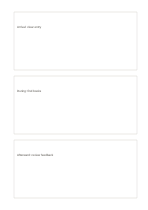

# Three stacked cards

`three-stacked-cards` · `cards` · `a5-draft`

[繁體中文](README.zh-TW.md) · [English](README.en.md) · [日本語](README.ja.md) · [Back to catalog](../../docs/en/catalog.md)

Keep before, during, and after entries in three separate stacked cards. Geometry change: stacked cards: 3.

## When to use it

**Geometry relationship:** `parameter` · [two-stacked-cards](../two-stacked-cards/README.en.md)

- Separate an observation, a possible explanation and a next check into three stacked cards.
- Use three independent areas for reflections before, during and after an event.

## How to use it

1. Assign one topic to each card from top to bottom, keeping its notes and evidence together.
2. Use the worked example to place entries in region order: 1: "Arrival: clear entry"; 2: "During: find books"; 3: "Afterward: review feedback"
3. Review the regions, mark open questions and choose a next step.

## What the page helps you see

Separate units that can be reordered, compared, or selected.

## Worked example

Entries in example-position order; each number identifies one entry:

1. Arrival: clear entry
2. During: find books
3. Afterward: review feedback

[SVG](examples/en.svg)

## When not to use it

Borders interrupt long continuous notes; more stages call for a flow page or a card-count variant. Small cells hold short phrases rather than long paragraphs.

## Downloads

- [Wordless SVG](exports/a5-draft/blank.svg)
- [Wordless PDF](exports/a5-draft/blank.pdf)
- [PDF with English name at top left](exports/a5-draft/titled.pdf)
- [Darker-ink wordless PDF](exports/a5-contrast/blank.pdf)
- [Darker-ink SVG](exports/a5-contrast/blank.svg)

The English name appears only on the titled PDF; the wordless version remains available for free writing.

Page size: A5 (148 × 210 mm); profile: `a5-draft`.

## Provenance and status

Generic geometry · Detailed source record: [manifest.json](manifest.json)  
[MIT license scope](../../LICENSE-SCOPE.md)

[Trilingual glossary](../../docs/en/glossary.md)

## Modify and rebuild

Edit geometry in `src/noteformats/variants.py` or text in `src/noteformats/variant_content.py`, then run from the project root:

`python scripts/build.py --ids three-stacked-cards`
