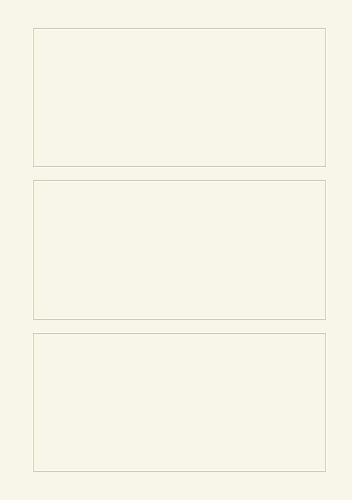
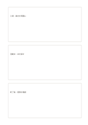

# 縦に三枚のカード

`three-stacked-cards` · `cards` · `a5-draft`

[繁體中文](README.zh-TW.md) · [English](README.en.md) · [日本語](README.ja.md) · [一覧へ戻る](../../docs/ja/catalog.md)

前・中・後の情報を三枚の縦のカードに分け、順序を確かめます。 図形の変更： 縦のカード数: 3.

## 向いている場面

**図形の対応:** `parameter` · [two-stacked-cards](../two-stacked-cards/README.ja.md)

- 観察した現象・考えられる解釈・次の確認を上下三枚のカードに分けるとき。
- 催しの前・最中・後の振り返りを三つの独立した欄に残すとき。

## 使い方

1. 上から各カードに一つの話題を割り当て、記録と根拠をまとめます。
2. 記入例を参考に、領域の順で記します：1「入場：案内を明確に」；2「活動中：本を探す」；3「終了後：感想を確認」
3. 各領域を読み返し、未確認の点と次の行動を記します。

## 記入後に見えること

項目を分けて、並べ替えや比較、選択ができます。

## 記入例

図の記入位置の順に示します。番号一つが一つの記入例です：

1. 入場：案内を明確に
2. 活動中：本を探す
3. 終了後：感想を確認

[SVG](examples/ja.svg)

## 向いていない場面

長い連続記録は枠で途切れます。段階が多い場合は流れ図か枚数違いの変種を使います。 小さなマスは短い語句向けで、長い文章には向きません。

## ダウンロード

- [文字なしSVG](exports/a5-draft/blank.svg)
- [文字なしPDF](exports/a5-draft/blank.pdf)
- [左上に英語名があるPDF](exports/a5-draft/titled.pdf)
- [濃い線の文字なしPDF](exports/a5-contrast/blank.pdf)
- [濃い線のSVG](exports/a5-contrast/blank.svg)

英語名は表題付きPDFだけに印刷され、文字なし版は自由な記入に使えます。

用紙サイズ：A5（148 × 210 mm）。設定ファイル：`a5-draft`。

## 由来と状態

一般的な幾何構造 · 詳しい由来の記録： [manifest.json](manifest.json)  
[MITライセンスの範囲](../../LICENSE-SCOPE.md)

[三言語の用語集](../../docs/ja/glossary.md)

## 変更と再生成

図形は `src/noteformats/variants.py`、文章は `src/noteformats/variant_content.py` を変更し、プロジェクトのルートで実行します：

`python scripts/build.py --ids three-stacked-cards`
