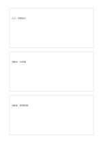

# 上下三卡

`three-stacked-cards` · `cards` · `a5-draft`

[繁體中文](README.zh-TW.md) · [English](README.en.md) · [日本語](README.ja.md) · [返回目錄](../../docs/zh-TW/catalog.md)

將前、中、後三段資訊分開記錄，再檢查順序。 本款的幾何變化： 上下卡片數: 3.

## 適合情境

**幾何對照:** `parameter` · [two-stacked-cards](../two-stacked-cards/README.zh-TW.md)

- 把一次觀察拆為現象、可能解釋與下一步查證三張上下卡。
- 用三個獨立區塊分別記錄活動前、進行中與結束後的反思。

## 使用步驟

1. 由上到下為各卡指定一項主題，讓文字與證據留在同一卡內。
2. 參考本頁示例，各區依序記錄：1「入口：清楚指引」；2「活動中：找到書」；3「活動後：整理回饋」
3. 回看各區，標記仍待查證的內容，再決定下一步。

## 整理後可得到

把可移動的事項分開，方便排序、比較或選擇。

## 實際填寫示例

依圖中填寫位置順序列出，每個編號是一筆示例條目：

1. 入口：清楚指引
2. 活動中：找到書
3. 活動後：整理回饋

[SVG](examples/zh-TW.svg)

## 不適合情境

長篇連續記錄會被卡片邊界打斷；更多階段應改用流程或變體。 細小格子只宜短語，不適合長篇段落。

## 下載

- [無字 SVG](exports/a5-draft/blank.svg)
- [無字 PDF](exports/a5-draft/blank.pdf)
- [左上角英文名稱 PDF](exports/a5-draft/titled.pdf)
- [深色墨線無字 PDF](exports/a5-contrast/blank.pdf)
- [深色墨線 SVG](exports/a5-contrast/blank.svg)

英文名稱只印在標題版 PDF；無字版仍適合自由列印與改作。

頁面尺寸：A5（148 × 210 mm）；設定檔：`a5-draft`。

## 來源與狀態

通用幾何結構 · 詳細來源紀錄見 [manifest.json](manifest.json)  
[MIT 授權範圍](../../LICENSE-SCOPE.md)

[三語術語表](../../docs/zh-TW/glossary.md)

## 修改與重新生成

調整 `src/noteformats/variants.py` 的幾何或 `src/noteformats/variant_content.py` 的文字，再於專案根目錄執行：

`python scripts/build.py --ids three-stacked-cards`
