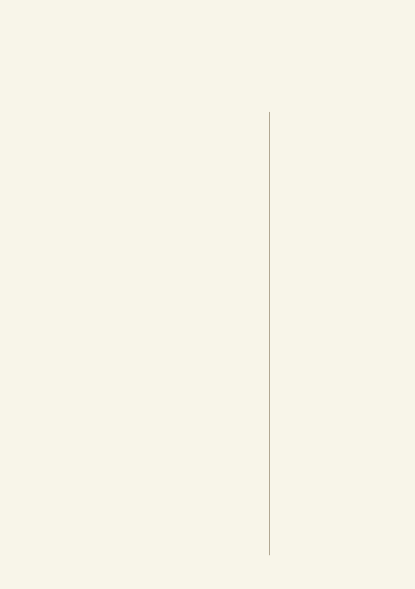
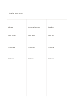

# Three-way comparison

`three-way-comparison` · `comparison` · `a5-draft`

[繁體中文](README.zh-TW.md) · [English](README.en.md) · [日本語](README.ja.md) · [Back to catalog](../../docs/en/catalog.md)

Compare three answers beneath one shared question.

## When to use it

**Geometry relationship:** `parameter` · [three-columns](../three-columns/README.en.md)

- Choose among three community-event venues.
- Compare three articles' views on the same issue.

## How to use it

1. Write the shared question in the top band.
2. Give each column one option and align similar criteria where possible.
3. Review evidence gaps before drawing a conclusion from filled columns.

## What the page helps you see

Options compared against shared criteria rather than one impression.

## Worked example

Three fictional reading-group venues are compared: library, community center, and pavilion.

[SVG](examples/en.svg)

## When not to use it

Narrow columns cannot hold long evidence; precise scoring needs a table with units.

## Downloads

- [Wordless SVG](exports/a5-draft/blank.svg)
- [Wordless PDF](exports/a5-draft/blank.pdf)
- [PDF with English name at top left](exports/a5-draft/titled.pdf)
- [Darker-ink wordless PDF](exports/a5-contrast/blank.pdf)
- [Darker-ink SVG](exports/a5-contrast/blank.svg)

The English name appears only on the titled PDF; the wordless version remains available for free writing.

Page size: A5 (148 × 210 mm); profile: `a5-draft`.

## Provenance and status

Adaptation of a traditional format · Detailed source record: [manifest.json](manifest.json)  
[MIT license scope](../../LICENSE-SCOPE.md)

[Trilingual glossary](../../docs/en/glossary.md)

## Modify and rebuild

Change `profiles/a5-draft.json` or the corresponding builder in `src/noteformats/layouts/`, then run from the project root:

`python scripts/build.py --ids three-way-comparison`
