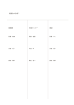

# 三案の比較

`three-way-comparison` · `comparison` · `a5-draft`

[繁體中文](README.zh-TW.md) · [English](README.en.md) · [日本語](README.ja.md) · [一覧へ戻る](../../docs/ja/catalog.md)

一つの問いの下で三つの答えを並べて比べます。

## 向いている場面

**図形の対応:** `parameter` · [three-columns](../three-columns/README.ja.md)

- 地域の催しの会場を三案から考えるとき。
- 同じ問題について三つの記事の見方を比べるとき。

## 使い方

1. 上段に共通の問いを書きます。
2. 各欄に一案を置き、同じ条件を近い高さに並べます。
3. 欄を埋めただけで結論にせず、根拠の欠けを確認します。

## 記入後に見えること

同じ条件で選択肢を見比べ、一つの印象だけで決めることを避けられます。

## 記入例

架空の読書会について図書館、地域センター、東屋の三会場を比べています。

[SVG](examples/ja.svg)

## 向いていない場面

欄が狭く長い根拠は書けません。正確な点数には単位付きの表が必要です。

## ダウンロード

- [文字なしSVG](exports/a5-draft/blank.svg)
- [文字なしPDF](exports/a5-draft/blank.pdf)
- [左上に英語名があるPDF](exports/a5-draft/titled.pdf)
- [濃い線の文字なしPDF](exports/a5-contrast/blank.pdf)
- [濃い線のSVG](exports/a5-contrast/blank.svg)

英語名は表題付きPDFだけに印刷され、文字なし版は自由な記入に使えます。

用紙サイズ：A5（148 × 210 mm）。設定ファイル：`a5-draft`。

## 由来と状態

伝統的な形式の応用 · 詳しい由来の記録： [manifest.json](manifest.json)  
[MITライセンスの範囲](../../LICENSE-SCOPE.md)

[三言語の用語集](../../docs/ja/glossary.md)

## 変更と再生成

`profiles/a5-draft.json` または `src/noteformats/layouts/` の描画関数を変更し、プロジェクトのルートで実行します：

`python scripts/build.py --ids three-way-comparison`
