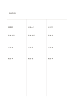

# 三方比較

`three-way-comparison` · `comparison` · `a5-draft`

[繁體中文](README.zh-TW.md) · [English](README.en.md) · [日本語](README.ja.md) · [返回目錄](../../docs/zh-TW/catalog.md)

同一個問題下，把三種答案放到三個欄位對照。

## 適合情境

**幾何對照:** `parameter` · [three-columns](../three-columns/README.zh-TW.md)

- 選擇三種可能的社區活動場地。
- 比較三篇文章對同一問題的看法。

## 使用步驟

1. 先在上方寫同一個比較問題。
2. 每欄只放一個方案，盡量沿相近高度記同類條件。
3. 回看每欄仍缺的證據，不因欄位填滿就下結論。

## 整理後可得到

用同一組條件逐一比較選項，避免只憑單一印象。

## 實際填寫示例

示例問虛構讀書會的場地，三欄比較圖書館、社區中心與戶外亭。

[SVG](examples/zh-TW.svg)

## 不適合情境

每欄窄，不適合長篇證據敘述；精確評分應另用有單位的表。

## 下載

- [無字 SVG](exports/a5-draft/blank.svg)
- [無字 PDF](exports/a5-draft/blank.pdf)
- [左上角英文名稱 PDF](exports/a5-draft/titled.pdf)
- [深色墨線無字 PDF](exports/a5-contrast/blank.pdf)
- [深色墨線 SVG](exports/a5-contrast/blank.svg)

英文名稱只印在標題版 PDF；無字版仍適合自由列印與改作。

頁面尺寸：A5（148 × 210 mm）；設定檔：`a5-draft`。

## 來源與狀態

傳統格式改編 · 詳細來源紀錄見 [manifest.json](manifest.json)  
[MIT 授權範圍](../../LICENSE-SCOPE.md)

[三語術語表](../../docs/zh-TW/glossary.md)

## 修改與重新生成

修改 `profiles/a5-draft.json` 或 `src/noteformats/layouts/` 內對應的繪圖函式，再於專案根目錄執行：

`python scripts/build.py --ids three-way-comparison`
