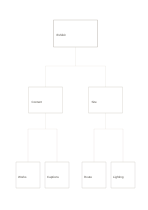

# Top-down hierarchy tree

`top-down-tree` · `hierarchy` · `a5-draft`

[繁體中文](README.zh-TW.md) · [English](README.en.md) · [日本語](README.ja.md) · [Back to catalog](../../docs/en/catalog.md)

Break a whole into two levels of smaller categories while keeping parent-child relations clear.

## When to use it

- Split a small event into two work areas and four tasks.
- Outline a chapter as theme, sections, and key points.

## How to use it

1. Name a bounded whole at the top.
2. Choose two distinct middle categories.
3. Put two concrete children under each and revise categories if an item does not fit.

## What the page helps you see

Levels of a goal or topic, with gaps easier to notice.

## Worked example

A fictional exhibition splits into content and site: works and captions under content, route and lighting under site.

[SVG](examples/en.svg)

## When not to use it

A tree only shows containment; use a network for cross-category links or loops.

## Downloads

- [Wordless SVG](exports/a5-draft/blank.svg)
- [Wordless PDF](exports/a5-draft/blank.pdf)
- [PDF with English name at top left](exports/a5-draft/titled.pdf)
- [Darker-ink wordless PDF](exports/a5-contrast/blank.pdf)
- [Darker-ink SVG](exports/a5-contrast/blank.svg)

The English name appears only on the titled PDF; the wordless version remains available for free writing.

Page size: A5 (148 × 210 mm); profile: `a5-draft`.

## Provenance and status

Common geometry · Detailed source record: [manifest.json](manifest.json)  
[MIT license scope](../../LICENSE-SCOPE.md)

[Trilingual glossary](../../docs/en/glossary.md)

## Modify and rebuild

Change `profiles/a5-draft.json` or the corresponding builder in `src/noteformats/layouts/`, then run from the project root:

`python scripts/build.py --ids top-down-tree`
