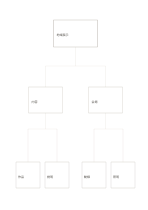

# 上から下への階層樹

`top-down-tree` · `hierarchy` · `a5-draft`

[繁體中文](README.zh-TW.md) · [English](README.en.md) · [日本語](README.ja.md) · [一覧へ戻る](../../docs/ja/catalog.md)

全体から小さな分類へ二段階で分け、親子の関係を示します。

## 向いている場面

- 小さな催しを二つの作業分野と四つの仕事に分けるとき。
- 章のテーマ、節、要点を整理するとき。

## 使い方

1. 頂点に範囲を決めた全体を書きます。
2. 中段を重ならない二分類にします。
3. 各分類に具体例を二つ置き、合わない項目が出たら分類を直します。

## 記入後に見えること

目的や話題の階層と、抜けている要素が見えます。

## 記入例

架空の展示を内容と会場に分け、内容には作品と説明、会場には動線と照明を置きます。

[SVG](examples/ja.svg)

## 向いていない場面

樹は上下の所属を示すだけです。分類をまたぐ線や循環にはネットワーク図が向きます。

## ダウンロード

- [文字なしSVG](exports/a5-draft/blank.svg)
- [文字なしPDF](exports/a5-draft/blank.pdf)
- [左上に英語名があるPDF](exports/a5-draft/titled.pdf)
- [濃い線の文字なしPDF](exports/a5-contrast/blank.pdf)
- [濃い線のSVG](exports/a5-contrast/blank.svg)

英語名は表題付きPDFだけに印刷され、文字なし版は自由な記入に使えます。

用紙サイズ：A5（148 × 210 mm）。設定ファイル：`a5-draft`。

## 由来と状態

一般的な幾何構造 · 詳しい由来の記録： [manifest.json](manifest.json)  
[MITライセンスの範囲](../../LICENSE-SCOPE.md)

[三言語の用語集](../../docs/ja/glossary.md)

## 変更と再生成

`profiles/a5-draft.json` または `src/noteformats/layouts/` の描画関数を変更し、プロジェクトのルートで実行します：

`python scripts/build.py --ids top-down-tree`
