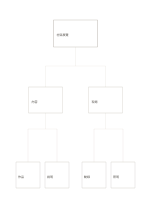

# 由上而下的層級樹

`top-down-tree` · `hierarchy` · `a5-draft`

[繁體中文](README.zh-TW.md) · [English](README.en.md) · [日本語](README.ja.md) · [返回目錄](../../docs/zh-TW/catalog.md)

從總題依兩層分解成較小的類別，保留父子關係。

## 適合情境

- 把一場活動拆成兩個工作面向及四項任務。
- 整理一章內容的主題、小節與要點。

## 使用步驟

1. 頂部寫範圍清楚的總題。
2. 中層分成兩個互不重疊的大類。
3. 底層每類各寫兩個具體子項，無法分類時回頭修訂大類。

## 整理後可得到

區分上位目標與下位要素，檢查是否遺漏。

## 實際填寫示例

虛構展覽的總題分成內容與現場，前者含作品、說明，後者含動線、照明。

[SVG](examples/zh-TW.svg)

## 不適合情境

樹只表示上下歸屬；跨類連結或循環關係需另用網絡圖。

## 下載

- [無字 SVG](exports/a5-draft/blank.svg)
- [無字 PDF](exports/a5-draft/blank.pdf)
- [左上角英文名稱 PDF](exports/a5-draft/titled.pdf)
- [深色墨線無字 PDF](exports/a5-contrast/blank.pdf)
- [深色墨線 SVG](exports/a5-contrast/blank.svg)

英文名稱只印在標題版 PDF；無字版仍適合自由列印與改作。

頁面尺寸：A5（148 × 210 mm）；設定檔：`a5-draft`。

## 來源與狀態

通用幾何結構 · 詳細來源紀錄見 [manifest.json](manifest.json)  
[MIT 授權範圍](../../LICENSE-SCOPE.md)

[三語術語表](../../docs/zh-TW/glossary.md)

## 修改與重新生成

修改 `profiles/a5-draft.json` 或 `src/noteformats/layouts/` 內對應的繪圖函式，再於專案根目錄執行：

`python scripts/build.py --ids top-down-tree`
