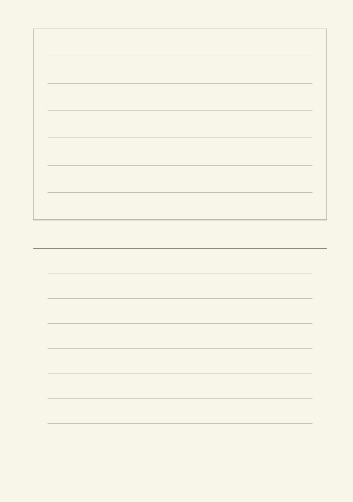
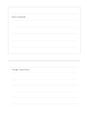

# Excerpt above, thoughts below

`top-excerpt-bottom-thoughts` · `research` · `a5-draft`

[繁體中文](README.zh-TW.md) · [English](README.en.md) · [日本語](README.ja.md) · [Back to catalog](../../docs/en/catalog.md)

Keep a quotation or observation above and personal questions and interpretations below.

## When to use it

- Separate an article's wording from your own understanding.
- Distinguish a gallery observation from later ideas.

## How to use it

1. Copy a short excerpt above and note a traceable source nearby.
2. Write your interpretation and one question below.
3. Recheck which words belong to the source and which are inferences.

## What the page helps you see

Sources, quotations, claims, and open checks kept distinct.

## Worked example

A fictional notice says 'Open on weekends' above; below, the reader asks whether transit makes it useful for workers.

[SVG](examples/en.svg)

## When not to use it

The upper area is not a complete citation system; long quotations and reuse rights still need separate care.

## Downloads

- [Wordless SVG](exports/a5-draft/blank.svg)
- [Wordless PDF](exports/a5-draft/blank.pdf)
- [PDF with English name at top left](exports/a5-draft/titled.pdf)
- [Darker-ink wordless PDF](exports/a5-contrast/blank.pdf)
- [Darker-ink SVG](exports/a5-contrast/blank.svg)

The English name appears only on the titled PDF; the wordless version remains available for free writing.

Page size: A5 (148 × 210 mm); profile: `a5-draft`.

## Provenance and status

Original layout · Detailed source record: [manifest.json](manifest.json)  
[MIT license scope](../../LICENSE-SCOPE.md)

[Trilingual glossary](../../docs/en/glossary.md)

## Modify and rebuild

Change `profiles/a5-draft.json` or the corresponding builder in `src/noteformats/layouts/`, then run from the project root:

`python scripts/build.py --ids top-excerpt-bottom-thoughts`
