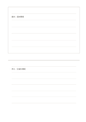

# 上に抜粋、下に考え

`top-excerpt-bottom-thoughts` · `research` · `a5-draft`

[繁體中文](README.zh-TW.md) · [English](README.en.md) · [日本語](README.ja.md) · [一覧へ戻る](../../docs/ja/catalog.md)

引用や観察を上に、自分の疑問と解釈を下に分けます。

## 向いている場面

- 記事の原文と自分の理解を区別するとき。
- 展示で見たことと後で考えたことを分けるとき。

## 使い方

1. 上に短い抜粋と後から確認できる出典を書きます。
2. 下に解釈と一つの疑問を書きます。
3. 原文の言葉と自分の推論が混ざっていないか見直します。

## 記入後に見えること

資料、引用、主張、未確認事項を分けられます。

## 記入例

架空の案内文『週末に開場』を上へ、下には『交通を調べたい』という考えを書きます。

[SVG](examples/ja.svg)

## 向いていない場面

上の欄だけで文献管理は完結しません。長い引用や再利用の権利は別途確認します。

## ダウンロード

- [文字なしSVG](exports/a5-draft/blank.svg)
- [文字なしPDF](exports/a5-draft/blank.pdf)
- [左上に英語名があるPDF](exports/a5-draft/titled.pdf)
- [濃い線の文字なしPDF](exports/a5-contrast/blank.pdf)
- [濃い線のSVG](exports/a5-contrast/blank.svg)

英語名は表題付きPDFだけに印刷され、文字なし版は自由な記入に使えます。

用紙サイズ：A5（148 × 210 mm）。設定ファイル：`a5-draft`。

## 由来と状態

本プロジェクトの独自レイアウト · 詳しい由来の記録： [manifest.json](manifest.json)  
[MITライセンスの範囲](../../LICENSE-SCOPE.md)

[三言語の用語集](../../docs/ja/glossary.md)

## 変更と再生成

`profiles/a5-draft.json` または `src/noteformats/layouts/` の描画関数を変更し、プロジェクトのルートで実行します：

`python scripts/build.py --ids top-excerpt-bottom-thoughts`
