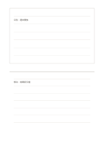

# 摘錄與思考上下區

`top-excerpt-bottom-thoughts` · `research` · `a5-draft`

[繁體中文](README.zh-TW.md) · [English](README.en.md) · [日本語](README.ja.md) · [返回目錄](../../docs/zh-TW/catalog.md)

把引文或觀察放在上半，自己的疑問與解讀留在下半。

## 適合情境

- 閱讀一段公開文章後區分原文與個人理解。
- 記錄展覽觀察時分開現場描述和後續想法。

## 使用步驟

1. 上區抄寫短摘錄並在旁註明可回查的來源。
2. 下區先寫自己的解讀，再列一個待查問題。
3. 回看上區，標清哪些是原文、哪些是推論。

## 整理後可得到

分開來源、引文、主張與待查問題。

## 實際填寫示例

用虛構展覽公告的一句『週末開放』作上區摘錄；下區寫『可能適合上班族，但需確認交通』。

[SVG](examples/zh-TW.svg)

## 不適合情境

上區不是完整文獻管理系統；長篇引文與引用權利仍需另行處理。

## 下載

- [無字 SVG](exports/a5-draft/blank.svg)
- [無字 PDF](exports/a5-draft/blank.pdf)
- [左上角英文名稱 PDF](exports/a5-draft/titled.pdf)
- [深色墨線無字 PDF](exports/a5-contrast/blank.pdf)
- [深色墨線 SVG](exports/a5-contrast/blank.svg)

英文名稱只印在標題版 PDF；無字版仍適合自由列印與改作。

頁面尺寸：A5（148 × 210 mm）；設定檔：`a5-draft`。

## 來源與狀態

本專案原創版面 · 詳細來源紀錄見 [manifest.json](manifest.json)  
[MIT 授權範圍](../../LICENSE-SCOPE.md)

[三語術語表](../../docs/zh-TW/glossary.md)

## 修改與重新生成

修改 `profiles/a5-draft.json` 或 `src/noteformats/layouts/` 內對應的繪圖函式，再於專案根目錄執行：

`python scripts/build.py --ids top-excerpt-bottom-thoughts`
