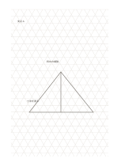

# 三角方眼

`triangular-grid` · `geometry` · `a5-draft`

[繁體中文](README.zh-TW.md) · [English](README.en.md) · [日本語](README.ja.md) · [一覧へ戻る](../../docs/ja/catalog.md)

三方向の等間隔線で斜めの構造や三角形の分割を下描きします。

## 向いている場面

- 三角形の部材を組み合わせる配置を描くとき。
- 斜めの支え方を比べるとき。

## 使い方

1. 三角形の一辺が表す仮の尺度を決めます。
2. 三方向の線に沿って輪郭を描き、縮図を精密な測定と混同しません。
3. 実測が必要な角度や寸法を別に記します。

## 記入後に見えること

向き、比率、配置と、追加で測る箇所が見えます。

## 記入例

架空の展示台で三つの支点と斜めの補強を描き、寸法は後で測る例です。

[SVG](examples/ja.svg)

## 向いていない場面

長文や長方形の表は読みづらく、尺度未確認の方眼は製図道具の代わりにはなりません。

## ダウンロード

- [文字なしSVG](exports/a5-draft/blank.svg)
- [文字なしPDF](exports/a5-draft/blank.pdf)
- [左上に英語名があるPDF](exports/a5-draft/titled.pdf)
- [濃い線の文字なしPDF](exports/a5-contrast/blank.pdf)
- [濃い線のSVG](exports/a5-contrast/blank.svg)

英語名は表題付きPDFだけに印刷され、文字なし版は自由な記入に使えます。

用紙サイズ：A5（148 × 210 mm）。設定ファイル：`a5-draft`。

## 由来と状態

伝統的な練習紙の応用 · 詳しい由来の記録： [manifest.json](manifest.json)  
[MITライセンスの範囲](../../LICENSE-SCOPE.md)

[三言語の用語集](../../docs/ja/glossary.md)

## 変更と再生成

`profiles/a5-draft.json` または `src/noteformats/layouts/` の描画関数を変更し、プロジェクトのルートで実行します：

`python scripts/build.py --ids triangular-grid`
