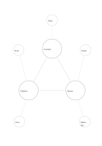

# Three-core relationship map

`triple-core-network` · `concept-network` · `a5-draft`

[繁體中文](README.zh-TW.md) · [English](README.en.md) · [日本語](README.ja.md) · [Back to catalog](../../docs/en/catalog.md)

Inspect three interacting core factors together with their outer conditions.

## When to use it

- Discuss how content, staffing, and space interact in a small event.
- Compare a course's goals, time, and materials as dependencies.

## How to use it

1. Give each inner circle one core factor.
2. Put concrete conditions outside and connect each to its closest core.
3. Check each inner relationship against available facts.

## What the page helps you see

A map of topics, branches, and relationships still to verify.

## Worked example

A fictional reading event uses content, helpers, and space as cores, with topic, host, seating, time, and materials outside.

[SVG](examples/en.svg)

## When not to use it

Edges are hypotheses, not proof of causation, and the outer circles cannot hold long evidence notes.

## Downloads

- [Wordless SVG](exports/a5-draft/blank.svg)
- [Wordless PDF](exports/a5-draft/blank.pdf)
- [PDF with English name at top left](exports/a5-draft/titled.pdf)
- [Darker-ink wordless PDF](exports/a5-contrast/blank.pdf)
- [Darker-ink SVG](exports/a5-contrast/blank.svg)

The English name appears only on the titled PDF; the wordless version remains available for free writing.

Page size: A5 (148 × 210 mm); profile: `a5-draft`.

## Provenance and status

Original layout · Detailed source record: [manifest.json](manifest.json)  
[MIT license scope](../../LICENSE-SCOPE.md)

[Trilingual glossary](../../docs/en/glossary.md)

## Modify and rebuild

Change `profiles/a5-draft.json` or the corresponding builder in `src/noteformats/layouts/`, then run from the project root:

`python scripts/build.py --ids triple-core-network`
