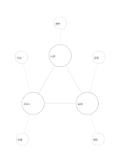

# 三つの核の関係図

`triple-core-network` · `concept-network` · `a5-draft`

[繁體中文](README.zh-TW.md) · [English](README.en.md) · [日本語](README.ja.md) · [一覧へ戻る](../../docs/ja/catalog.md)

相互に関係する三つの中心要因と、それぞれの外部条件を見ます。

## 向いている場面

- 小さな催しで内容、人手、空間がどう関わるか考えるとき。
- 講座の目標、時間、材料の依存を整理するとき。

## 使い方

1. 中央の三円に核となる要因を一つずつ書きます。
2. 具体的な条件を外側に置き、関係する核へつなぎます。
3. 内側の関係線を事実と照らして確かめます。

## 記入後に見えること

主題と枝、確かめ直す関係を一覧できます。

## 記入例

架空の読書会で内容、手伝い、会場を核にし、題材、司会、座席、時間、資料を外へ置きます。

[SVG](examples/ja.svg)

## 向いていない場面

線は仮説であり因果の証明ではありません。外円も長い根拠の記録には向きません。

## ダウンロード

- [文字なしSVG](exports/a5-draft/blank.svg)
- [文字なしPDF](exports/a5-draft/blank.pdf)
- [左上に英語名があるPDF](exports/a5-draft/titled.pdf)
- [濃い線の文字なしPDF](exports/a5-contrast/blank.pdf)
- [濃い線のSVG](exports/a5-contrast/blank.svg)

英語名は表題付きPDFだけに印刷され、文字なし版は自由な記入に使えます。

用紙サイズ：A5（148 × 210 mm）。設定ファイル：`a5-draft`。

## 由来と状態

本プロジェクトの独自レイアウト · 詳しい由来の記録： [manifest.json](manifest.json)  
[MITライセンスの範囲](../../LICENSE-SCOPE.md)

[三言語の用語集](../../docs/ja/glossary.md)

## 変更と再生成

`profiles/a5-draft.json` または `src/noteformats/layouts/` の描画関数を変更し、プロジェクトのルートで実行します：

`python scripts/build.py --ids triple-core-network`
