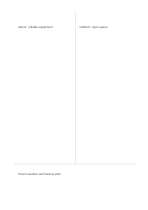

# Two columns with synthesis

`two-columns-summary` · `columns` · `a5-draft`

[繁體中文](README.zh-TW.md) · [English](README.en.md) · [日本語](README.ja.md) · [Back to catalog](../../docs/en/catalog.md)

Keep two viewpoints distinct above, then write a combined conclusion across the bottom.

## When to use it

- Compare two sources before drafting a tentative shared conclusion.
- Discuss two options and name a compromise that still needs checking.

## How to use it

1. Assign one source or option to each upper side.
2. Put comparable points and differences at similar heights.
3. Write what the evidence currently supports and what remains unresolved in the bottom band.

## What the page helps you see

Parallel notes whose agreements, differences, and unanswered points can be checked.

## Worked example

Indoor and outdoor venues for a fictional reading group are compared; weather and a backup plan remain the synthesis question.

[SVG](examples/en.svg)

## When not to use it

If one side is much longer, equal upper columns waste space; the bottom band is not for a full report.

## Downloads

- [Wordless SVG](exports/a5-draft/blank.svg)
- [Wordless PDF](exports/a5-draft/blank.pdf)
- [PDF with English name at top left](exports/a5-draft/titled.pdf)
- [Darker-ink wordless PDF](exports/a5-contrast/blank.pdf)
- [Darker-ink SVG](exports/a5-contrast/blank.svg)

The English name appears only on the titled PDF; the wordless version remains available for free writing.

Page size: A5 (148 × 210 mm); profile: `a5-draft`.

## Provenance and status

Original layout · Detailed source record: [manifest.json](manifest.json)  
[MIT license scope](../../LICENSE-SCOPE.md)

[Trilingual glossary](../../docs/en/glossary.md)

## Modify and rebuild

Change `profiles/a5-draft.json` or the corresponding builder in `src/noteformats/layouts/`, then run from the project root:

`python scripts/build.py --ids two-columns-summary`
