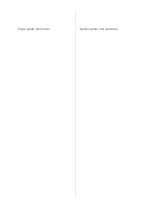

# Equal two columns

`two-equal-columns` · `columns` · `a5-draft`

[繁體中文](README.zh-TW.md) · [English](README.en.md) · [日本語](README.ja.md) · [Back to catalog](../../docs/en/catalog.md)

Place two equally important streams side by side for rowwise or whole-page comparison.

## When to use it

- Compare what two short articles say about one question.
- Place an original passage beside your own rewrite.

## How to use it

1. Decide what each side represents and write that meaning in your notes.
2. Keep corresponding items at similar heights, adding arrows if useful.
3. Look for items present on only one side and note which source needs checking.

## What the page helps you see

Parallel notes whose agreements, differences, and unanswered points can be checked.

## Worked example

A fictional exhibition's paper and spoken guides are compared by what visitors can learn and ask.

[SVG](examples/en.svg)

## When not to use it

Equal width wastes room when one side holds only short cues and the other needs long notes.

## Downloads

- [Wordless SVG](exports/a5-draft/blank.svg)
- [Wordless PDF](exports/a5-draft/blank.pdf)
- [PDF with English name at top left](exports/a5-draft/titled.pdf)
- [Darker-ink wordless PDF](exports/a5-contrast/blank.pdf)
- [Darker-ink SVG](exports/a5-contrast/blank.svg)

The English name appears only on the titled PDF; the wordless version remains available for free writing.

Page size: A5 (148 × 210 mm); profile: `a5-draft`.

## Provenance and status

Generic geometry · Detailed source record: [manifest.json](manifest.json)  
[MIT license scope](../../LICENSE-SCOPE.md)

[Trilingual glossary](../../docs/en/glossary.md)

## Modify and rebuild

Change `profiles/a5-draft.json` or the corresponding builder in `src/noteformats/layouts/`, then run from the project root:

`python scripts/build.py --ids two-equal-columns`
