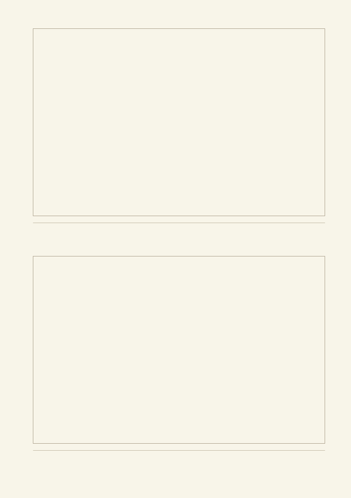
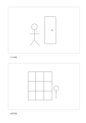

# 雙草圖筆記

`two-sketch-notes` · `storyboard` · `a5-draft`

[繁體中文](README.zh-TW.md) · [English](README.en.md) · [日本語](README.ja.md) · [返回目錄](../../docs/zh-TW/catalog.md)

用連續畫格描繪同一事件的變化，並在每格留下動作提示。 本款的幾何變化： 故事板畫格數: 2.

## 適合情境

**幾何對照:** `parameter` · [storyboard-6](../storyboard-6/README.zh-TW.md)

- 並列記錄物件修改前與修改後的兩張草圖，另記改動理由。
- 用兩個畫面比較同一入口在白天與夜晚的辨識方式。

## 使用步驟

1. 先把事件分成與本頁畫格數相符的關鍵場景，每格畫出可見的變化。
2. 參考本頁示例，各區依序記錄：1「入口草圖」；2「內部草圖」
3. 回看各區，標記仍待查證的內容，再決定下一步。

## 整理後可得到

從連續畫面看出事件轉折與仍缺的鏡頭。

## 實際填寫示例

依圖中填寫位置順序列出，每個編號是一筆示例條目：

1. 入口草圖
2. 內部草圖

[SVG](examples/zh-TW.svg)

## 不適合情境

兩個畫面適合成對比較，無法單獨交代三個以上的連續狀態；若要說明改動過程，應另加流程或更多畫格。

## 下載

- [無字 SVG](exports/a5-draft/blank.svg)
- [無字 PDF](exports/a5-draft/blank.pdf)
- [左上角英文名稱 PDF](exports/a5-draft/titled.pdf)
- [深色墨線無字 PDF](exports/a5-contrast/blank.pdf)
- [深色墨線 SVG](exports/a5-contrast/blank.svg)

英文名稱只印在標題版 PDF；無字版仍適合自由列印與改作。

頁面尺寸：A5（148 × 210 mm）；設定檔：`a5-draft`。

## 來源與狀態

傳統格式改編 · 詳細來源紀錄見 [manifest.json](manifest.json)  
[MIT 授權範圍](../../LICENSE-SCOPE.md)

[三語術語表](../../docs/zh-TW/glossary.md)

## 修改與重新生成

調整 `src/noteformats/variants.py` 的幾何或 `src/noteformats/variant_content.py` 的文字，再於專案根目錄執行：

`python scripts/build.py --ids two-sketch-notes`
