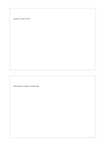

# Two stacked cards

`two-stacked-cards` · `cards` · `a5-draft`

[繁體中文](README.zh-TW.md) · [English](README.en.md) · [日本語](README.ja.md) · [Back to catalog](../../docs/en/catalog.md)

Use two separate vertical cards for two stages or viewpoints.

## When to use it

- Separate an observation from a hypothesis still to check.
- Record impressions before and after an event.

## How to use it

1. Define the role of the upper and lower card.
2. Keep one main topic in each rather than mixing stages.
3. Compare the two and note what still lacks an explanation.

## What the page helps you see

Separate units that can be reordered, compared, or selected.

## Worked example

A fictional exhibition uses the top card for arrival observations and the bottom for questions left afterward.

[SVG](examples/en.svg)

## When not to use it

Borders interrupt long continuous notes; more stages call for a flow page or a card-count variant.

## Downloads

- [Wordless SVG](exports/a5-draft/blank.svg)
- [Wordless PDF](exports/a5-draft/blank.pdf)
- [PDF with English name at top left](exports/a5-draft/titled.pdf)
- [Darker-ink wordless PDF](exports/a5-contrast/blank.pdf)
- [Darker-ink SVG](exports/a5-contrast/blank.svg)

The English name appears only on the titled PDF; the wordless version remains available for free writing.

Page size: A5 (148 × 210 mm); profile: `a5-draft`.

## Provenance and status

Generic geometry · Detailed source record: [manifest.json](manifest.json)  
[MIT license scope](../../LICENSE-SCOPE.md)

[Trilingual glossary](../../docs/en/glossary.md)

## Modify and rebuild

Change `profiles/a5-draft.json` or the corresponding builder in `src/noteformats/layouts/`, then run from the project root:

`python scripts/build.py --ids two-stacked-cards`
