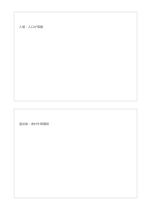

# 上下二枚のカード

`two-stacked-cards` · `cards` · `a5-draft`

[繁體中文](README.zh-TW.md) · [English](README.en.md) · [日本語](README.ja.md) · [一覧へ戻る](../../docs/ja/catalog.md)

上下の独立した枠に二つの段階や見方を分けて書きます。

## 向いている場面

- 観察と未確認の仮説を分けるとき。
- 催しの前後の印象を分けるとき。

## 使い方

1. 上と下の枠の役割を決めます。
2. 各枠では一つの主題だけを扱い、段階を混ぜません。
3. 二つを比べ、まだ説明できない点を記します。

## 記入後に見えること

項目を分けて、並べ替えや比較、選択ができます。

## 記入例

架空の展示会で上に入場時の観察、下に退出後に残った問いを書いています。

[SVG](examples/ja.svg)

## 向いていない場面

長い連続記録は枠で途切れます。段階が多い場合は流れ図か枚数違いの変種を使います。

## ダウンロード

- [文字なしSVG](exports/a5-draft/blank.svg)
- [文字なしPDF](exports/a5-draft/blank.pdf)
- [左上に英語名があるPDF](exports/a5-draft/titled.pdf)
- [濃い線の文字なしPDF](exports/a5-contrast/blank.pdf)
- [濃い線のSVG](exports/a5-contrast/blank.svg)

英語名は表題付きPDFだけに印刷され、文字なし版は自由な記入に使えます。

用紙サイズ：A5（148 × 210 mm）。設定ファイル：`a5-draft`。

## 由来と状態

一般的な幾何構造 · 詳しい由来の記録： [manifest.json](manifest.json)  
[MITライセンスの範囲](../../LICENSE-SCOPE.md)

[三言語の用語集](../../docs/ja/glossary.md)

## 変更と再生成

`profiles/a5-draft.json` または `src/noteformats/layouts/` の描画関数を変更し、プロジェクトのルートで実行します：

`python scripts/build.py --ids two-stacked-cards`
