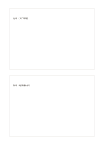

# 上下雙卡

`two-stacked-cards` · `cards` · `a5-draft`

[繁體中文](README.zh-TW.md) · [English](README.en.md) · [日本語](README.ja.md) · [返回目錄](../../docs/zh-TW/catalog.md)

用上下兩張獨立卡片記錄兩個階段或兩種觀點。

## 適合情境

- 先寫觀察，再寫尚待確認的推測。
- 把活動前與活動後的印象分開。

## 使用步驟

1. 先定義上卡與下卡各承擔的內容。
2. 各卡只寫一個主要主題，避免交叉混寫。
3. 回看兩卡的差異，記下仍無法解釋的地方。

## 整理後可得到

把可移動的事項分開，方便排序、比較或選擇。

## 實際填寫示例

示例上卡記虛構展覽的進場觀察，下卡記離場後仍有的問題。

[SVG](examples/zh-TW.svg)

## 不適合情境

長篇連續記錄會被卡片邊界打斷；更多階段應改用流程或變體。

## 下載

- [無字 SVG](exports/a5-draft/blank.svg)
- [無字 PDF](exports/a5-draft/blank.pdf)
- [左上角英文名稱 PDF](exports/a5-draft/titled.pdf)
- [深色墨線無字 PDF](exports/a5-contrast/blank.pdf)
- [深色墨線 SVG](exports/a5-contrast/blank.svg)

英文名稱只印在標題版 PDF；無字版仍適合自由列印與改作。

頁面尺寸：A5（148 × 210 mm）；設定檔：`a5-draft`。

## 來源與狀態

通用幾何結構 · 詳細來源紀錄見 [manifest.json](manifest.json)  
[MIT 授權範圍](../../LICENSE-SCOPE.md)

[三語術語表](../../docs/zh-TW/glossary.md)

## 修改與重新生成

修改 `profiles/a5-draft.json` 或 `src/noteformats/layouts/` 內對應的繪圖函式，再於專案根目錄執行：

`python scripts/build.py --ids two-stacked-cards`
