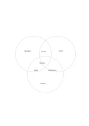

# Three-circle Venn diagram

`venn-three` · `comparison` · `a5-draft`

[繁體中文](README.zh-TW.md) · [English](README.en.md) · [日本語](README.ja.md) · [Back to catalog](../../docs/en/catalog.md)

Inspect exclusive, pairwise-shared, and three-way-shared items across three groups.

## When to use it

- Compare resources used by three learning activities.
- Find a concern mentioned by three sources.

## How to use it

1. Assign one group to each circle.
2. Fill exclusive regions first, then pairwise overlaps.
3. Check the central overlap last so items shared by only two groups are not misplaced.

## What the page helps you see

Options compared against shared criteria rather than one impression.

## Worked example

For a fictional lecture, workshop, and tour, speaker/tools/route are exclusive; seats, Q&A, and hands-on activity are pairwise; signup is shared by all three.

[SVG](examples/en.svg)

## When not to use it

Intersections are small and fit phrases, not long lists or precise quantities.

## Downloads

- [Wordless SVG](exports/a5-draft/blank.svg)
- [Wordless PDF](exports/a5-draft/blank.pdf)
- [PDF with English name at top left](exports/a5-draft/titled.pdf)
- [Darker-ink wordless PDF](exports/a5-contrast/blank.pdf)
- [Darker-ink SVG](exports/a5-contrast/blank.svg)

The English name appears only on the titled PDF; the wordless version remains available for free writing.

Page size: A5 (148 × 210 mm); profile: `a5-draft`.

## Provenance and status

Adaptation of an existing method · Detailed source record: [manifest.json](manifest.json)  
[MIT license scope](../../LICENSE-SCOPE.md)

[Trilingual glossary](../../docs/en/glossary.md)

## Modify and rebuild

Change `profiles/a5-draft.json` or the corresponding builder in `src/noteformats/layouts/`, then run from the project root:

`python scripts/build.py --ids venn-three`
