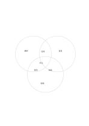

# 三円のベン図

`venn-three` · `comparison` · `a5-draft`

[繁體中文](README.zh-TW.md) · [English](README.en.md) · [日本語](README.ja.md) · [一覧へ戻る](../../docs/ja/catalog.md)

三組の固有部分、二組の共通部分、三組すべての共通部分を見ます。

## 向いている場面

- 三種類の学習活動で使う資源を比べるとき。
- 三つの資料に共通する問いを探すとき。

## 使い方

1. 三つの円に組を一つずつ割り当てます。
2. まず固有部分、次に二組の重なりを埋めます。
3. 最後に中央を確認し、二組だけの項目を三組共通と誤らないようにします。

## 記入後に見えること

同じ条件で選択肢を見比べ、一つの印象だけで決めることを避けられます。

## 記入例

架空の講演・実習・見学で、講師・道具・経路は固有、座席・質問・体験は二組ずつ、申込は三組に共通します。

[SVG](examples/ja.svg)

## 向いていない場面

重なる場所が小さく、短い語句向けです。大量の項目や正確な数量には表を使います。

## ダウンロード

- [文字なしSVG](exports/a5-draft/blank.svg)
- [文字なしPDF](exports/a5-draft/blank.pdf)
- [左上に英語名があるPDF](exports/a5-draft/titled.pdf)
- [濃い線の文字なしPDF](exports/a5-contrast/blank.pdf)
- [濃い線のSVG](exports/a5-contrast/blank.svg)

英語名は表題付きPDFだけに印刷され、文字なし版は自由な記入に使えます。

用紙サイズ：A5（148 × 210 mm）。設定ファイル：`a5-draft`。

## 由来と状態

既存の方法を配置に応用 · 詳しい由来の記録： [manifest.json](manifest.json)  
[MITライセンスの範囲](../../LICENSE-SCOPE.md)

[三言語の用語集](../../docs/ja/glossary.md)

## 変更と再生成

`profiles/a5-draft.json` または `src/noteformats/layouts/` の描画関数を変更し、プロジェクトのルートで実行します：

`python scripts/build.py --ids venn-three`
