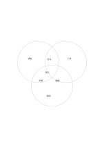

# 三圓交集圖

`venn-three` · `comparison` · `a5-draft`

[繁體中文](README.zh-TW.md) · [English](README.en.md) · [日本語](README.ja.md) · [返回目錄](../../docs/zh-TW/catalog.md)

同時查看三組內容的獨有、兩兩共通與三方共通部分。

## 適合情境

- 比較三種課程活動使用的資源。
- 尋找三篇資料都提到的同一問題。

## 使用步驟

1. 替三個圓各指定一組內容。
2. 先填各自獨有的項目，再填兩兩交集。
3. 最後核對中央三方交集，避免把只屬兩組的項目放進去。

## 整理後可得到

用同一組條件逐一比較選項，避免只憑單一印象。

## 實際填寫示例

虛構的講座、工作坊與導覽：講者、工具、路線各自獨有；座位、問答、體驗屬兩兩交集；報名屬三方共通。

[SVG](examples/zh-TW.svg)

## 不適合情境

交集區很小，只容短語；要列大量項目或精確數量時應改用表格。

## 下載

- [無字 SVG](exports/a5-draft/blank.svg)
- [無字 PDF](exports/a5-draft/blank.pdf)
- [左上角英文名稱 PDF](exports/a5-draft/titled.pdf)
- [深色墨線無字 PDF](exports/a5-contrast/blank.pdf)
- [深色墨線 SVG](exports/a5-contrast/blank.svg)

英文名稱只印在標題版 PDF；無字版仍適合自由列印與改作。

頁面尺寸：A5（148 × 210 mm）；設定檔：`a5-draft`。

## 來源與狀態

既有方法的版面改編 · 詳細來源紀錄見 [manifest.json](manifest.json)  
[MIT 授權範圍](../../LICENSE-SCOPE.md)

[三語術語表](../../docs/zh-TW/glossary.md)

## 修改與重新生成

修改 `profiles/a5-draft.json` 或 `src/noteformats/layouts/` 內對應的繪圖函式，再於專案根目錄執行：

`python scripts/build.py --ids venn-three`
