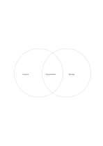

# Two-circle Venn diagram

`venn-two` · `comparison` · `a5-draft`

[繁體中文](README.zh-TW.md) · [English](README.en.md) · [日本語](README.ja.md) · [Back to catalog](../../docs/en/catalog.md)

Separate features belonging to either group from those shared by both.

## When to use it

- Compare materials needed by two event formats.
- Find overlap and differences between two articles.

## How to use it

1. Decide what the left and right circles each represent.
2. Write exclusive items outside the overlap and shared items in it.
3. Check for items that belong to neither and note them separately.

## What the page helps you see

Options compared against shared criteria rather than one impression.

## Worked example

Indoor and outdoor versions of a fictional reading group have chairs and shade separately, while a discussion question is shared.

[SVG](examples/en.svg)

## When not to use it

Circle area is not a statistical scale; exact counts or many intersections need another representation.

## Downloads

- [Wordless SVG](exports/a5-draft/blank.svg)
- [Wordless PDF](exports/a5-draft/blank.pdf)
- [PDF with English name at top left](exports/a5-draft/titled.pdf)
- [Darker-ink wordless PDF](exports/a5-contrast/blank.pdf)
- [Darker-ink SVG](exports/a5-contrast/blank.svg)

The English name appears only on the titled PDF; the wordless version remains available for free writing.

Page size: A5 (148 × 210 mm); profile: `a5-draft`.

## Provenance and status

Adaptation of an existing method · Detailed source record: [manifest.json](manifest.json)  
[MIT license scope](../../LICENSE-SCOPE.md)

[Trilingual glossary](../../docs/en/glossary.md)

## Modify and rebuild

Change `profiles/a5-draft.json` or the corresponding builder in `src/noteformats/layouts/`, then run from the project root:

`python scripts/build.py --ids venn-two`
