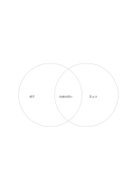

# 二円のベン図

`venn-two` · `comparison` · `a5-draft`

[繁體中文](README.zh-TW.md) · [English](README.en.md) · [日本語](README.ja.md) · [一覧へ戻る](../../docs/ja/catalog.md)

二つの円でそれぞれだけの特徴と共通部分を分けます。

## 向いている場面

- 二種類の催しに必要な材料を比べるとき。
- 二つの記事の重なりと違いを整理するとき。

## 使い方

1. 左右の円が何の集合か決めます。
2. 片方だけの項目は外側、共通の項目は重なりに書きます。
3. どちらにも属さない項目がないか見直し、別に記します。

## 記入後に見えること

同じ条件で選択肢を見比べ、一つの印象だけで決めることを避けられます。

## 記入例

架空の読書会の屋内・屋外案で、椅子と日よけは片側ずつ、討論の問いは共通部に置きます。

[SVG](examples/ja.svg)

## 向いていない場面

円の面積は統計の尺度ではありません。正確な数や多くの交差には別の表現が必要です。

## ダウンロード

- [文字なしSVG](exports/a5-draft/blank.svg)
- [文字なしPDF](exports/a5-draft/blank.pdf)
- [左上に英語名があるPDF](exports/a5-draft/titled.pdf)
- [濃い線の文字なしPDF](exports/a5-contrast/blank.pdf)
- [濃い線のSVG](exports/a5-contrast/blank.svg)

英語名は表題付きPDFだけに印刷され、文字なし版は自由な記入に使えます。

用紙サイズ：A5（148 × 210 mm）。設定ファイル：`a5-draft`。

## 由来と状態

既存の方法を配置に応用 · 詳しい由来の記録： [manifest.json](manifest.json)  
[MITライセンスの範囲](../../LICENSE-SCOPE.md)

[三言語の用語集](../../docs/ja/glossary.md)

## 変更と再生成

`profiles/a5-draft.json` または `src/noteformats/layouts/` の描画関数を変更し、プロジェクトのルートで実行します：

`python scripts/build.py --ids venn-two`
