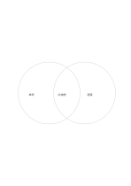

# 雙圓交集圖

`venn-two` · `comparison` · `a5-draft`

[繁體中文](README.zh-TW.md) · [English](README.en.md) · [日本語](README.ja.md) · [返回目錄](../../docs/zh-TW/catalog.md)

用兩個重疊圓區分各自特點與共同部分。

## 適合情境

- 比較兩種活動都需要的材料。
- 整理兩篇文章重合與各自獨有的觀點。

## 使用步驟

1. 先決定左右圓各代表哪個集合。
2. 只屬於一邊的項目寫在非重疊處，共有的寫在交集。
3. 回看是否有項目其實不屬於任何一邊，另做註記。

## 整理後可得到

用同一組條件逐一比較選項，避免只憑單一印象。

## 實際填寫示例

示例比較虛構讀書會的室內與戶外活動：桌椅與遮蔭各在一側，共通的討論題在交集。

[SVG](examples/zh-TW.svg)

## 不適合情境

需要精確數量、比例或複雜多重交集時，圓的位置不代表統計尺度。

## 下載

- [無字 SVG](exports/a5-draft/blank.svg)
- [無字 PDF](exports/a5-draft/blank.pdf)
- [左上角英文名稱 PDF](exports/a5-draft/titled.pdf)
- [深色墨線無字 PDF](exports/a5-contrast/blank.pdf)
- [深色墨線 SVG](exports/a5-contrast/blank.svg)

英文名稱只印在標題版 PDF；無字版仍適合自由列印與改作。

頁面尺寸：A5（148 × 210 mm）；設定檔：`a5-draft`。

## 來源與狀態

既有方法的版面改編 · 詳細來源紀錄見 [manifest.json](manifest.json)  
[MIT 授權範圍](../../LICENSE-SCOPE.md)

[三語術語表](../../docs/zh-TW/glossary.md)

## 修改與重新生成

修改 `profiles/a5-draft.json` 或 `src/noteformats/layouts/` 內對應的繪圖函式，再於專案根目錄執行：

`python scripts/build.py --ids venn-two`
