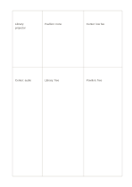

# Weighted-size matrix

`weighted-matrix` · `matrix` · `a5-draft`

[繁體中文](README.zh-TW.md) · [English](README.en.md) · [日本語](README.ja.md) · [Back to catalog](../../docs/en/catalog.md)

Allow unequal writing space while comparing options against the same criteria. Geometry change: Three columns by two rows with unequal widths and heights.

## When to use it

**Geometry relationship:** `parameter` · [matrix-2x3](../matrix-2x3/README.en.md)

- Compare three event proposals, reserving the taller row for constraints needing longer explanations.
- Compare excerpts and short comments from three articles using unequal cells to fit their different lengths.

## How to use it

1. Assign larger cells to entries needing more explanation; cell area is not a score.
2. Use the worked example to place entries in region order: 1: "Library: projector"; 2: "Center: audio"; 3: "Pavilion: none"; 4: "Library: free"; 5: "Center: low fee"; 6: "Pavilion: free"
3. Review the regions, mark open questions and choose a next step.

## What the page helps you see

Intersections, missing cells, and tradeoffs across chosen dimensions.

## Worked example

Entries in example-position order; each number identifies one entry:

1. Library: projector
2. Center: audio
3. Pavilion: none
4. Library: free
5. Center: low fee
6. Pavilion: free

[SVG](examples/en.svg)

## When not to use it

Unequal cells allocate writing space rather than mathematical weights; a total score requires explicit coefficients, a rating scale and a calculation method elsewhere.

## Downloads

- [Wordless SVG](exports/a5-draft/blank.svg)
- [Wordless PDF](exports/a5-draft/blank.pdf)
- [PDF with English name at top left](exports/a5-draft/titled.pdf)
- [Darker-ink wordless PDF](exports/a5-contrast/blank.pdf)
- [Darker-ink SVG](exports/a5-contrast/blank.svg)

The English name appears only on the titled PDF; the wordless version remains available for free writing.

Page size: A5 (148 × 210 mm); profile: `a5-draft`.

## Provenance and status

Generic geometry · Detailed source record: [manifest.json](manifest.json)  
[MIT license scope](../../LICENSE-SCOPE.md)

[Trilingual glossary](../../docs/en/glossary.md)

## Modify and rebuild

Edit geometry in `src/noteformats/variants.py` or text in `src/noteformats/variant_content.py`, then run from the project root:

`python scripts/build.py --ids weighted-matrix`
