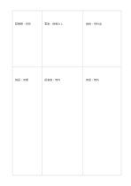

# 幅の異なる比較表

`weighted-matrix` · `matrix` · `a5-draft`

[繁體中文](README.zh-TW.md) · [English](README.en.md) · [日本語](README.ja.md) · [一覧へ戻る](../../docs/ja/catalog.md)

書く量に応じて幅を変えながら、同じ条件で案を比べます。 図形の変更： 三列二行で、列幅と行高を異なる比率にしました。

## 向いている場面

**図形の対応:** `parameter` · [matrix-2x3](../matrix-2x3/README.ja.md)

- 三つの催し案を比べ、長い説明が必要な制約に高さのある行を割り当てるとき。
- 三記事の引用と短評を比べ、内容の長さに応じて大小のマスを使うとき。

## 使い方

1. 説明量に合わせて広いマスを割り当て、面積を点数と混同しません。
2. 記入例を参考に、領域の順で記します：1「図書館：投影」；2「施設：音響」；3「東屋：設備なし」；4「図書館：無料」；5「施設：低料金」；6「東屋：無料」
3. 各領域を読み返し、未確認の点と次の行動を記します。

## 記入後に見えること

複数の観点が交わる場所と、空白や選択上の差が見えます。

## 記入例

図の記入位置の順に示します。番号一つが一つの記入例です：

1. 図書館：投影
2. 施設：音響
3. 東屋：設備なし
4. 図書館：無料
5. 施設：低料金
6. 東屋：無料

[SVG](examples/ja.svg)

## 向いていない場面

大小のマスは記入量を配分するもので、数学的な重みを定めてはいません。合計点には係数・評価尺度・計算方法を別に記します。

## ダウンロード

- [文字なしSVG](exports/a5-draft/blank.svg)
- [文字なしPDF](exports/a5-draft/blank.pdf)
- [左上に英語名があるPDF](exports/a5-draft/titled.pdf)
- [濃い線の文字なしPDF](exports/a5-contrast/blank.pdf)
- [濃い線のSVG](exports/a5-contrast/blank.svg)

英語名は表題付きPDFだけに印刷され、文字なし版は自由な記入に使えます。

用紙サイズ：A5（148 × 210 mm）。設定ファイル：`a5-draft`。

## 由来と状態

一般的な幾何構造 · 詳しい由来の記録： [manifest.json](manifest.json)  
[MITライセンスの範囲](../../LICENSE-SCOPE.md)

[三言語の用語集](../../docs/ja/glossary.md)

## 変更と再生成

図形は `src/noteformats/variants.py`、文章は `src/noteformats/variant_content.py` を変更し、プロジェクトのルートで実行します：

`python scripts/build.py --ids weighted-matrix`
