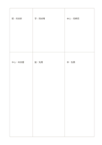

# 不等寬比較矩陣

`weighted-matrix` · `matrix` · `a5-draft`

[繁體中文](README.zh-TW.md) · [English](README.en.md) · [日本語](README.ja.md) · [返回目錄](../../docs/zh-TW/catalog.md)

以不同寬度保留較多書寫空間，但仍以同一條件比較方案。 本款的幾何變化： 三欄兩行，欄寬與行高改為不等比例。

## 適合情境

**幾何對照:** `parameter` · [matrix-2x3](../matrix-2x3/README.zh-TW.md)

- 比較三個活動方案時，將較高的資料列留給需要長句解釋的限制。
- 對照三份文章的摘句與短評，依內容長度使用不等大的格子。

## 使用步驟

1. 先將較寬的欄或較高的列分配給需要更多說明的項目；面積不代表分數。
2. 參考本頁示例，各區依序記錄：1「館：有投影」；2「中心：有音響」；3「亭：無設備」；4「館：免費」；5「中心：低費用」；6「亭：免費」
3. 回看各區，標記仍待查證的內容，再決定下一步。

## 整理後可得到

看見兩個以上維度交叉處的資料缺口與取捨。

## 實際填寫示例

依圖中填寫位置順序列出，每個編號是一筆示例條目：

1. 館：有投影
2. 中心：有音響
3. 亭：無設備
4. 館：免費
5. 中心：低費用
6. 亭：免費

[SVG](examples/zh-TW.svg)

## 不適合情境

不等大的格子只是分配書寫空間，並未定義數學權重；若要計算總分，須另列係數、評分尺度與計算方式。

## 下載

- [無字 SVG](exports/a5-draft/blank.svg)
- [無字 PDF](exports/a5-draft/blank.pdf)
- [左上角英文名稱 PDF](exports/a5-draft/titled.pdf)
- [深色墨線無字 PDF](exports/a5-contrast/blank.pdf)
- [深色墨線 SVG](exports/a5-contrast/blank.svg)

英文名稱只印在標題版 PDF；無字版仍適合自由列印與改作。

頁面尺寸：A5（148 × 210 mm）；設定檔：`a5-draft`。

## 來源與狀態

通用幾何結構 · 詳細來源紀錄見 [manifest.json](manifest.json)  
[MIT 授權範圍](../../LICENSE-SCOPE.md)

[三語術語表](../../docs/zh-TW/glossary.md)

## 修改與重新生成

調整 `src/noteformats/variants.py` 的幾何或 `src/noteformats/variant_content.py` 的文字，再於專案根目錄執行：

`python scripts/build.py --ids weighted-matrix`
